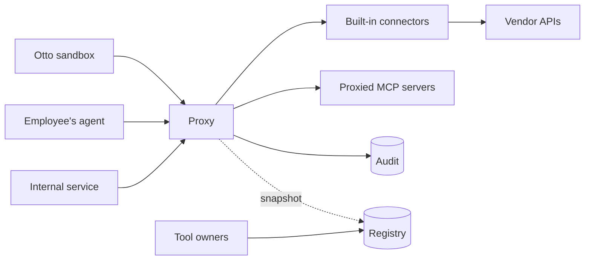

# MCP gateway design

Date: 2026-09-30, revised 2026-10-01 against Otto `752395a` and after an independent design
review, 2026-10-04 and 2026-10-06 for the classifications in section 8, and 2026-10-07 for
decisions 0009 (audit and receipts), 0010 (routes around the gateway), 0011 (resource
authorization and tool assurance) and 0012 (turn grants). Status: draft.
Settled questions and the ones still open are in
[open-questions.md](open-questions.md); open ones are not yet accepted requirements.

## 1. Purpose

This is the one MCP path for Org: every agent the gateway serves is offered it as its path to
tools. The gateway proves who is calling, decides
whether the call is allowed, shows each caller only the tools it may use, attaches the
credential on the server side, and writes an audit row before it answers.

"The one path" is a property of the environments agents run in, not of this service alone. It
holds only where three controls hold: nothing provisioned to the agent holds or yields a
credential for a target system; the agent reaches target systems and self-built MCP servers
only through the gateway; and each self-built server the gateway proxies accepts only the
gateway's credential. Each environment that serves agents carries one of two claims, "the only
path" or "the governed path", shown by evidence from inside it; employees' laptops are the
governed path. See [decision 0010](decisions/0010-what-stops-an-agent-going-around-the-gateway.md)
and [route-exceptions.md](route-exceptions.md).

This is built to find out what such a gateway looks like, without a comparison against
extending Otto's gateway or adopting an existing one first; see
[decision 0005](decisions/0005-build-without-a-comparison-first.md).

Otto, Org's platform for running agents in Kubernetes sandboxes, is one caller among several.
It is also the only caller with a working gateway today (`cmd/otto-gateway` in the
`otto` repository, written in Go) and a written contract for how a gateway must behave.
This design takes the mechanisms from that contract and applies them company-wide, and keeps
Otto's stricter rules as policy for Otto's callers.

**Otto is one piece of this gateway, not its shape.** The core (identity, policy, audit,
credentials, connectors, proxied servers, tool surfaces and the registry) is written for every
caller and knows nothing about Otto. What is specific to Otto is confined to three places: a
policy profile, a delegation verifier for its turn grants, and a client for the interface
through which Otto supplies facts only it knows. Otto's endpoints, tables and release cadence
stay in Otto. Otto's contract decides when Otto can switch over. It does not decide what the core looks like, and it does
not hold up the rest of the company's path.

**Migration decision:** this gateway replaces Otto's Go MCP gateway, in stages: run alongside
it and compare, then take reads, then writes, then retire the Go gateway's MCP path. Until
each stage, the Go gateway remains Otto's path. Otto keeps its model broker and its
control-plane endpoints (`/repo-config`, `/pr-receipt`, `/pr-outcome`); when those endpoints
need something done in a vendor system, Otto's control plane asks this gateway to do it. See
decisions [0002](decisions/0002-replace-ottos-mcp-gateway.md) and
[0003](decisions/0003-otto-keeps-its-control-plane-endpoints.md).

### Sources

| Source | What this design takes from it |
| --- | --- |
| `otto/docs/05-mcp-gateway.md` | Classification, the denial contract, proved against claimed identity, audit before answer, boot gates. |
| `otto/docs/adr/0009-otto-builds-the-mcp-gateway.md` | Exactly one place decides authorization. |
| `otto/docs/02-control-plane.md` | Policy tiers, approval design, action receipts and failover fencing. Receipts: [decision 0009](decisions/0009-audit-completion-receipts-and-recovery.md). Fencing: [decision 0012](decisions/0012-what-a-turn-grant-binds.md). |
| [DoorDash's Agent Gateway write-up](https://careersatdoordash.com/blog/how-doordash-built-a-centralized-gateway-for-ai-agent-tool-access/) | The registry and proxy split, curated tool surfaces, self-serve onboarding, several credential modes. |

The control-plane document's asynchronous read-receipt proposal was not taken. Every tool
call has one synchronous path: begin before the tool runs, finish before the answer (section
11). Audit rows and action receipts serve different purposes. An audit row records one attempt
and does not prevent a duplicate effect; a receipt is what stops the gateway making one.

## 2. Callers

| Caller | How it proves itself | Who it acts for | Status | Claim (decision 0010) |
| --- | --- | --- | --- | --- |
| Internal service or scheduled automation | A workload token from a configured, trusted issuer. | A team (proved). | First: the first slice serves a mock one, then a real one. | The mock workload in kind: the only path to the mock server, once the kind run's evidence is current. A real workload: the governed path until the route check passes in its own namespace, which it must before it sees real data. |
| Otto sandbox | Kubernetes ServiceAccount token, checked against the cluster's OIDC issuer, plus a signed per-turn grant from Otto's control plane. | A team (proved from the token) and a human (attested by the control plane in the grant). | Exists; served by the Go gateway until its staged cutover. | The governed path. No turn has the only path while Otto's Go gateway serves any tool through its MCP path. After that, a sealed turn rises to the only path once its evidence exists and the audit row tells it from a turn with egress open. |
| Otto control plane | A workload token for a subject that is not a sandbox. | Otto itself, performing vendor actions for its own endpoints. | With Otto's cutover. | None: not an agent. |
| Employee's own agent, such as a coding assistant on a laptop | An access token for this gateway from the company identity provider, Okta. | That employee (proved). | After Otto. | The governed path. |

Agents hosted by outside vendors that would call in from the internet are deferred, and CI
runners are not served. Serving either would start with the governed path.

Employees connect through the company's private network or existing zero-trust access layer.
The laptop-facing deployment is separate from Otto's in-cluster deployment, sharing the
registry and audit store. The first clients, workflows and concrete access infrastructure
must be identified and tested before employee rollout (Q13).

## 3. Scope

### In scope

- Tools only, over MCP's HTTP transport: `tools/list` and `tools/call` in both revisions,
  `server/discover` in the newer one, and `initialize` and `ping` in the older one.
- Several identity issuers at once, one per caller type.
- Built-in connectors and proxied MCP servers, presented the same way to callers and held
  to different levels of assurance (section 13).
- A registry of servers, tools, owners, tool surfaces and policy.
- The systems listed in [systems.md](systems.md).
- Surfaces restricted to named workload subjects.
- Otto's security and behavioral contract, preserved for Otto's callers through conformance.
  Endpoint and tool-name changes are explicit migration mappings in Otto's configuration.

### Out of scope for now

- MCP resources, prompts and sampling.
- Servers that speak only stdio; they must be wrapped in an HTTP server first.
- Otto's model-call broker and control-plane endpoints, which stay in Otto.
- Human approval of individual calls, and grants of a capability to perform one specific
  action. Approval of a tool for a surface, turn grants and per-user grants are different
  things and are in scope.
- A registry UI. Configuration files come first, then an API.

## 4. Terms

| Term | Meaning |
| --- | --- |
| Caller | The process that sent the request. |
| Principal | What the gateway proved about the caller: a user, or a workload and its team. |
| Proved | Verified by the gateway from a signed token. |
| Claimed | Stated by the caller in a header, and not verified. |
| Profile | The policy set that applies to one caller type, such as Otto's. |
| Connector | Code that implements a group of tools against one external system. |
| Proxied server | A separate MCP server the gateway forwards to. |
| Classification | A tool's fixed label: `read`, `propose`, `write` or `destructive` (section 8). |
| A write | Any call that changes something: a `propose` tool or a `write` tool. Written as code, `write` is only the classification for direct writes. Receipts and recovery (decision 0009) apply to every write. |
| Tool surface | The named set of tools one endpoint exposes. |
| Brokering | The gateway attaches a credential on the server side; the caller never holds it. |

## 5. Architecture

- **Proxy (data plane).** Any instance can serve any request and an instance can be replaced
  at any time, but it is not stateless: it holds a registry snapshot, upstream session caches
  and audit completions still in flight. `tools/list` is answered from the snapshot's approved
  definitions, so neither the registry nor a proxied server is on that path. The audit store
  is on the request path, deliberately (section 11).
- **Registry (control plane).** The source of truth for servers, approved tools, owners, tool
  surfaces and policy. It starts as checked-in configuration files and becomes a Postgres
  service with an API when teams need to onboard without a pull request.

The proxy is built on `axum`, with the MCP endpoint written by hand behind a small protocol
adapter; see decisions [0001](decisions/0001-build-on-axum-not-pingora.md) and
[0007](decisions/0007-serve-two-mcp-revisions-from-a-hand-written-endpoint.md). It serves MCP
revisions `2026-07-28` and `2025-06-18` on one endpoint, without sessions in either. The
`rmcp` SDK is used only in tests, as a client.

### Proposed workspace layout

This is where the code is expected to end up. It starts as fewer crates, split along these
lines only once the interfaces between them have settled.

| Crate | Contents |
| --- | --- |
| `gateway-core` | Principals, classification, the decision function, the tool registry, the audit record type, denial sentences. No I/O. |
| `gateway-identity` | Token verifiers, one per issuer type, and the team manifest loader. |
| `audit-postgres` | The audit store over Postgres: the schema, its two roles, the migrations and the boot check. |
| `connector-github` | The GitHub connector, in the gateway's own process: Otto's GitHub tools, so far its nine reads other than skill bodies. Every token comes from the key custodian, through the client in `key-custodian`. A fake GitHub REST API behind `test-support`. |
| `key-custodian` | The key custodian (`switchboard-custodian`), the one process that holds the GitHub App key, and its client, a library module the GitHub connector depends on. The gateway never starts the key-holding process; it links the whole crate, server code too, until the crate gains a client-only feature (#219). |
| `gateway-otto` | The Otto adapter: Otto's policy profile, the turn-grant verifier and the client for Otto's resolver interface. The core crates do not depend on it. |
| `connector-proxy` | The connector that forwards to a separate MCP server. |
| `gateway-registry` | The registry file: approved tool definitions, surfaces, profiles, limits and profile selection, loaded into a core snapshot. |
| `gateway-mcp` | The MCP protocol adapter: JSON-RPC envelopes, the two revisions, header checks, rendering. No policy types. |
| `gateway` | The proxy binary (`switchboard`): HTTP handler, boot gates, the deployment file, wiring, registry reload. |
| `gateway-dev` | The gateway on the test fakes (`switchboard-dev`), a scripted client, and the end-to-end tests. |
| `mock-docs-server` | A mock document server that plays a proxied MCP server in tests and the demo. Shares no code with the gateway. |
| `demo-checks` | Tests for the demo's scripts and manifests in `deploy/`. No code of its own. |
| `registry` | The control-plane binary, once it exists. |
| `conformance` | The black-box suite, a fake vendor API and a fake MCP server. |

## 6. The request path

Callers connect to `/mcp/{surface}`. Every `tools/call` goes through these steps in order:

1. **Verify the caller** against the issuers configured for this deployment, and resolve the
   principal. A token naming any other issuer is refused; a token never chooses where keys
   are fetched from.
2. **Verify any delegation the request carries,** whether or not the profile requires one; the
   verifier needs no profile. For Otto this is the turn grant: its version, key, canonical
   encoding, signature, audience, lifetime and, once required, pod are checked. The verifier
   does not deny. A delegation that cannot be verified is passed on as unverified, carrying the
   kind of failure and, for a grant whose signature verified, its digest, and step 5 denies it
   at check 3 with a single reason kind of its own. That holds under a profile that does not
   require a delegation too: check 3 denies any delegation that is present and unverified. A
   grant that verifies but names a team other than the proved team is denied at check 3 too,
   naming both teams.
3. **Select the profile** from the issuer, the deployment and the principal.
4. **Parse** the JSON-RPC message and look up the tool in the surface.
5. **Decide**, by the checks of
   [decision 0006](decisions/0006-what-the-decision-function-sees.md) as amended, in this
   order, the first that fails giving the reason:
   - check 0, the profile exists; check 1, the surface is permitted to the principal; check 2,
     the tool is approved on the surface;
   - check 3, a delegation is present where the profile requires one, and any delegation that
     is present is verified and agrees with the principal;
   - check 4, the delegation lists the tool;
   - check 5, the profile permits the classification. `write` and `destructive` are denied
     before the profile is read, except a tool named in the profile's list of excepted tools
     once #12 builds it (decision 0011);
   - the currency check, under a profile that requires it, such as the profile for Otto's
     sandboxes: a call of a tool not classified `read` needs Otto's answer that the turn is
     current (decision 0012);
   - check 6, each named resource is within the caller's limit;
   - the key check, last: a call of a tool not classified `read` that carries no key is denied
     (decision 0009), so a caller is asked for a key only when the call would otherwise be
     allowed.
6. **Write the audit row.** The gateway assigns the row a UUIDv7 first. Begin has a budget,
   within which it is retried by that identifier. For a side effect, the receipt is reserved
   in the same transaction, and a reused key is answered there without running anything. If
   begin fails or its budget runs out, refuse the call.
7. **Check the arguments,** for a proxied tool, against its approved input schema, read as
   JSON Schema 2020-12. A schema in another dialect is refused or converted at approval. Where
   an object in the schema lists its properties, any other property is refused, at any depth.
   The gateway forwards its own serialization of the arguments, never the caller's bytes. A
   call that fails is completed with outcome `error`, and nothing is forwarded. A built-in
   connector parses the arguments into its own types instead. Either way, a side effect whose
   arguments are refused has its receipt settled as `not_performed` with the row.
8. **Run the tool** if allowed, with a brokered credential. The connector, the credential
   layer and the custodian may still refuse, never allow. A connector may refuse because of
   what the call names, such as a repository outside the team's scope. The gateway bounds the
   result's size and duration above any bound of the connector's own. A result over the bound
   is never cut short silently: for a `read` tool it is outcome `error`, and for any other tool
   it is `unknown` (decision 0009). For a proxied server the bounds are 64 KiB and 5 s unless
   its entry in the deployment file sets others, up to 1 MiB and 60 s. A connector in the
   gateway's own process is held by the gateway to 5 s and 1 MiB of JSON unless
   `[connectors.<name>]` sets others within the same ceilings; past its deadline a read is
   cancelled, and a side effect is answered `unknown` but left to run to its end, never
   cancelled once it may have been sent (#12). Before a proxied call is sent it takes a slot
   under two caps in the instance: 32 calls in flight to the server, and 8 from the caller's
   team to it. A call over either is completed as `refused` with a capacity sentence, and
   nothing is sent. Then every call, proxied or in the gateway's own process, takes a token
   from two rate quotas in the instance, the server's and the caller's team's on the server; a
   call over either is completed as `refused` with a sentence naming the scope and the server,
   and nothing is sent (#12). The instance's own cap, 256 requests in flight, is checked
   earlier, at admission, before the body is read: a request over it is answered 503, as
   telemetry, with no row
   ([decision 0014](decisions/0014-rollout-safeguards-and-audit-operations.md)).
9. **Complete the audit row** with the outcome (`ok`, `error`, `refused`, `unknown` or
   `duplicate`) and latency. The answer waits for this for at most the answer budget, and
   finish keeps retrying until its deadline.
10. **Answer.** A connector's refusal whose completion is not confirmed within the answer
   budget gets the audit-failure sentence, which is still true: nothing ran.

Steps 6 to 9 run on a task of their own, started before begin, so a client that disconnects
cannot cancel a write to the store. A disconnect before the connector is called stops the
call. A disconnect during a read cancels it. A side effect runs to its call deadline.

A failure at step 1, and a body that cannot be parsed, are telemetry events and do not pass
through step 6 (section 11). Steps 2 and 3 deny nothing, and step 4 refuses only a body it
cannot parse, as telemetry. A denial at step 5 still passes
through step 6 before the caller reads it, so an unverifiable delegation is a deny row.
`initialize`, `ping` and `server/discover` produce telemetry.

`tools/list` runs steps 1 to 5 for every tool in the surface and returns those that pass. It
decides with no resources and no key, and skips check 6, the currency check and the key check.
A `propose` tool is listed to a caller who may call it and denied on `tools/call` without a
key. It writes one row of kind `list`, complete, naming the tools returned. This is
deliberately stricter than Otto's Go gateway, which lists every served tool even under a grant
that permits only some; whether Otto's callers rely on that is checked when Otto's adapter is
built.

## 7. Identity

**Several issuers, one verifier interface.** Each deployment has a fixed list of issuers and
audiences. Each issuer has a kind (Kubernetes cluster, or company identity provider) and maps
a verified token to a principal, which is identified by issuer and subject together:

| Principal | Proved facts | From |
| --- | --- | --- |
| Workload | Subject, and the team the manifest maps it to, and, for a pod's token, the pod UID from its signed `kubernetes.io` claim. | A ServiceAccount token. |
| User | Subject and group memberships. | An identity-provider token. |

**Verification is strict and offline.** One signing algorithm, a key ID required, signing
keys fetched only from the issuer's own host, expiry and not-before checked with leeway,
audience membership required, and a ceiling on token lifetime.

**Keys can change without a restart.** Each issuer's keys come from one of two places the
deployment names. A keys file is read once, at boot. A keys URL, on the issuer's own origin
(the same scheme, host and port), is fetched at boot and again on a timer: every 300 seconds
unless the deployment says otherwise, and never more often than every 30. Each fetch is one
bounded request that follows no redirect. A first fetch that fails refuses to start. The URL is
configured, never discovered: nothing a token carries (`iss`, `jku`, `x5u`, an embedded `jwk`,
or `kid`) causes a fetch, and a token naming an unknown `kid` is refused until a scheduled
refresh brings its key.

Each refresh goes through the identity gate's replacement of one configured issuer's keys: it
builds a whole new verifier with the new set, which gets every check a set gets at boot, and
puts it in force only if that succeeds. A refused set, or a fetch that fails, leaves the keys in
use. The refresher names the issuer; nothing in a token chooses whose keys are replaced, and
keys for an issuer that is not configured are refused. Keys that cannot be refreshed stay in
force until a refresh succeeds, with no maximum age ([decision
0013](decisions/0013-registry-freshness-drift-and-withdrawal.md)). Refusing every token because
a refresh failed would turn an outage of the issuer's host into an outage of the gateway. Each
issuer's key age is exported instead, as `switchboard_issuer_keys_age_seconds{issuer}` (#91),
with an alert condition at four refresh intervals
([decision 0014](decisions/0014-rollout-safeguards-and-audit-operations.md)).

An `https` keys URL is fetched over TLS (#88), and needs `keys_ca_file`: a PEM bundle, read at
boot, whose CAs are the only ones trusted. No roots are compiled in and none are read from the
system: in Kubernetes the bundle is `kube-root-ca.crt`, and for a public issuer it is the image's
own CA bundle. The certificate is verified against the keys URL's host, a DNS name or an IP
address. The client is rustls with ring, passed to the client itself and never installed as the
process default; it offers HTTP/1.1 only, and the deadline covers the TLS handshake. An issuer
whose keys need a bearer token takes `keys_token_file`, read again on every fetch because the
kubelet rotates projected tokens, and sent to the keys URL only. Both are refused beside an
`http` keys URL. The kind demo fetches the cluster issuer's keys from the API server this way,
trusting `kube-root-ca.crt` and sending no token: the kind base binds
`system:service-account-issuer-discovery` to `system:unauthenticated`, and nothing else
([decision 0013](decisions/0013-registry-freshness-drift-and-withdrawal.md), section 10). The
Compose demo still uses a keys file, since its development issuer has an `https` name but is
served over `http`.

**Verification has three states:** `proved`, `disabled` (checking was explicitly turned off) and
`failed`. An incident review must be able to tell "we were not checking" from "someone tried and
was refused". For identity, "someone tried and was refused" is a telemetry event (section
11); for a delegation, it is a deny row. "We were not checking" writes no row, and none is
planned: with identity disabled the path lists nothing and refuses every `tools/call`, with no
row. Reads are not served with rows whose identity is `disabled`, and #69, which would have
built them, is not planned
([decision 0014](decisions/0014-rollout-safeguards-and-audit-operations.md)). Decision 0014
also makes identity disabled development-only: the release build refuses to start with it,
before it connects to anything (section 12).

**A wrong guess costs the same as a right one.** An unknown subject pays for the signature
check before it is refused, so response time does not reveal which subjects exist.

**Delegations.** A delegation is a signed statement from a trusted control plane about whom a
workload is acting for. Otto's is the turn grant: its control plane mints one per turn, naming
the session, turn, execution, team, acting human, fencing epoch, expiry and the tools that
turn may call. The sandbox presents it and cannot alter it. The acting human is therefore
attested by Otto's control plane; it is still not proof that the person pressed a key, and the
audit record keeps it in the claimed columns.

Otto signs grants with a shared secret today, so any verifier can also mint. Otto is asked to
sign them asymmetrically so this gateway holds only a public key; see
[decision 0004](decisions/0004-verify-turn-grants-with-a-public-key.md). A control plane that
delegates to this gateway signs with a key the gateway cannot use to sign.

What a grant binds is [decision 0012](decisions/0012-what-a-turn-grant-binds.md), and its exact
format, version `v3`, is [turn-grant-format.md](turn-grant-format.md). Its issuer is
fixed by the Ed25519 key that verifies it, one key per Otto environment. `aud` lists the gateway
deployments it is for, two during the cutover. `iat` and `exp` bound its lifetime to at most 15
minutes, with 30 seconds of leeway. `pod` binds it to the sandbox pod's UID, by stage 3 at the
latest. `egress` carries the turn's egress setting, which is recorded (decision 0010). Within
those bounds a grant may be presented any number of times, and every row records its digest, so
reuse from another pod, or another deployment sharing this gateway's audit store, is one query.
A call of any tool not classified `read` is also checked for currency: Otto's resolver says
whether the turn is still current, which enforces the fencing epoch and lets Otto revoke one
turn. Reads are not fenced. The Kubernetes verifier exposes the pod UID its token proves, and
the principal carries it. The verifier in `gateway-otto` binds a grant to it once the issuer
requires `pod`.

The gateway runs that verifier on every `tools/call` and `tools/list` that carries
`X-Otto-Turn-Grant`, whatever the caller's profile requires, against the deployment that
received the call, the proved principal and its pod, and the gateway's clock (#22). The
deployment file's `[grants]` table names each issuer's public key files, a previous key with
its absolute end instant, whether `pod` and `egress` are required, and the tool-name mapping.
The keys are read at boot only, so a key change is a restart: one rollout. A grant that
verifies becomes the call's verified delegation, its tools mapped to this gateway's names and
narrowed to those the surface serves. One that fails becomes a delegation that is present and
unverified, carrying the failure and, for a binding that failed after the signature verified,
the digest; check 3 denies it. A request with no grant has no delegation, and one with the
header twice carries a malformed grant. Without a `[grants]` table no issuer is configured, so
a grant a request carries is refused, and no profile a rule gives workloads may require a
delegation. Grant checking can be turned off only in a development build (section 12).

**Discovery for employees' agents.** The gateway publishes the metadata MCP's authorization
specification defines, so a standard client can find the identity provider and sign in without
per-user setup.

**What Rust adds.** Proved and claimed values get different types, for example
`Proved<TeamId>` and `Claimed<TeamId>`, and only a verifier can construct a `Proved`. Code
that needs a proved team cannot be handed a header value by mistake.

## 8. Policy

Policy has two layers. One function decides from who is calling, which tool and the resources
the call names; what can be known only while the tool runs is checked by the connector, and
both land in one audit record
([decision 0011](decisions/0011-resource-authorization-and-tool-assurance.md)).

**Classification, company-wide.** Every tool has exactly one classification, assigned by the
person who approves it. A tool with none never runs; there is no default.

| Classification | Meaning |
| --- | --- |
| `read` | Reads and changes nothing. |
| `propose` | Creates something for a person to review, or changes only what the gateway itself created for review: a draft pull request, an issue it opens, a commit to its own proposal branch, a comment on something it created for review. Nothing it does takes effect until a person acts on it. |
| `write` | Changes something directly: a merge, a push to a branch the gateway did not create for a proposal, a status transition, a configuration change, a comment on anything the gateway did not create for review. |
| `destructive` | Destroys something. |

A comment is `propose` only when it is on something the gateway itself created for review,
such as its own draft pull request or an issue it opened. A comment anywhere else is `write`,
because a comment can take effect on its own: a bot reads `/deploy` or `atlantis apply` as a
command, and a comment can trigger CI. The rule is about what the comment is on, not that
thing's state: a comment on the gateway's own pull request is still `propose` after a person
marks it ready for review, if its tool makes the guards below.

The decision function sees only the classification, not what the gateway created. A tool is
`propose` only if it refuses, when it runs, to act on anything the gateway did not create, by
a check such as the author being the gateway's own identity, a reserved branch prefix, or a
fact from Otto's resolver. A tool that cannot make that check is `write`.

Acting only on what the gateway created is not enough. A comment on the gateway's own pull
request can still be a command. So a `propose` tool must also guard, when it runs, against
anything that would take effect without a person acting. A guard is either a refusal or a
value the tool forces. Otto's tools show the cases. `github_pr_comment` refuses a comment whose
first word Atlantis would read as a command, on any pull request. `github_create_pr` forces a
draft, because the org's Atlantis plans every pull request that is not a draft, on a server
holding an AWS role. `github_amend_change` refuses to commit to a pull request a person has
marked ready for review, because Atlantis would plan the new commit.

A refusal is recorded as the outcome `refused`. A forced value is not a refusal: the call
completes with the outcome `ok`, and what it created is a draft. A `propose` tool has no
setting that turns a guard off. Otto has one, `CreateReadyPRs`, an operator flag that makes
`github_create_pr` open pull requests that are ready for review. It is not carried over; a
create-PR tool with such a setting is `write`.

The bots whose commands a comment tool refuses are named when the tool is approved: those
configured for the repositories or projects it can reach. Today that is Atlantis. CI cannot
be refused by what starts it: a draft pull request, a push to the gateway's proposal branch and
a comment each start the workflows configured for them. That is acceptable where those workflows
only build and test. Whether a proposal stays `propose` in a repository where a workflow that a
pull request, a push or a comment starts can deploy or holds a production credential is open
(Q9). It waits on the owners of Atlantis, CI and Jira automation. Until they answer, only
automation already named, which today is Atlantis comment commands, makes a tool `write`. A
proposal tool stays `propose` on the position above, and also refuses changes to CI workflow
files and to Atlantis configuration
([decision 0011](decisions/0011-resource-authorization-and-tool-assurance.md)). A proposal
that changes ordinary code or `.tf` files can still start an Atlantis autoplan, or a pull
request workflow that runs with the repository's secrets. That stays unguarded until then.

A change to something that exists, such as amending a proposal or editing a comment, is
`propose` only if the connector checks that the gateway created it for the same principal:
from the gateway's receipts, or from a delegating control plane's resolver. Without one of
them it is not `propose`. Decision 0009 goes further: no `propose` tool is served at all
until a receipt store is configured.

The guards are made by the connector, so the decision function cannot watch them. Each one,
the forced draft included, is tested like any other guard: the tool's connector has a test
against the fake vendor that fails without it, and a mutation that removes it (section 18).

Under this rule Otto's `github_pr_comment` and `jira_comment` are `write`: they comment on
pull requests and issues the gateway did not create. So is `addOrEditJiraIssueComment` on
Atlassian's hosted server, which [systems.md](systems.md) plans for the Jira surface. The owner
allowed Otto's two tools to Otto's callers by a narrow, recorded exception
([decision 0011](decisions/0011-resource-authorization-and-tool-assurance.md), section 9).
It is in the profile for Otto's sandboxes only, which requires currency, so each call is also
fenced (decision 0012); the profile for Otto's control-plane surface has no exception, and the
loader refuses an exception list on a profile that does not require currency. The tool refuses
the commands of the bots named when it is approved, today Atlantis; it reaches only the team's
repositories or the configured Jira projects; every call is audited; and it is listed in the
register of exceptions that decision 0010 keeps, with this project as its owner, accepted by
the owner, and to be signed by a named security owner, who has not yet been named. It is
reviewed every 90 days and before each milestone's rollout, so before milestone 4, when it
first comes into force, and when Otto's cutover (#13) completes. `addOrEditJiraIssueComment`
gets no exception, because it can edit other people's comments. The core has no way yet to
express the exception. Under #12, check 5 itself changes: it denies `write` and `destructive`
unless the tool is named in the calling profile's list of excepted tools, and an allowed call
records the exception that allowed it in a field of its own, not as a reason. The list names
tools, never a classification. The exception comes into force only once #12 has built it and
the security owner has signed its entry. Until then Otto's callers are denied both tools,
which loses parity with Otto's gateway.

**Profile rules, per caller type.** Classification, proved versus claimed identity, the denial
contract, audit before execution or ordinary denial, and fail-closed enforcement apply to all
profiles. `write` and `destructive` are denied in every profile by the decision function, so
no profile's data can permit them as a classification. That is how production mutation is
denied for every profile initially: anything that changes production without a person acting
is one of the two. The one exception is the recorded one for Otto's two comment tools, above,
which names tools in the profile for Otto's sandboxes and needs a change to check 5.
Permitting direct writes needs a decision that replaces part of
[decision 0006](decisions/0006-what-the-decision-function-sees.md). This binds calls through
the gateway. Where an environment's claim is the governed path, it says nothing about other
routes ([decision 0010](decisions/0010-what-stops-an-agent-going-around-the-gateway.md)).

| Rule | Otto profile | Employee profile | Service profile |
| --- | --- | --- | --- |
| Reads | Allowed. | Within the user's groups and approved data access; see section 9. | Allowed, within the team's surfaces. |
| Proposals (`propose`) | Allowed. A comment is a proposal only on something the gateway created for review, such as its own draft pull request or an issue it opened, and only if its tool refuses the commands of the bots named when it was approved. | Only approved tools on employee surfaces, always under the employee's own per-user grant, once that system's grant and receipts work (decision 0011). None at launch. | Allowed, with the same limit on comments. |
| Direct writes (`write`) | Never, except Otto's two comment tools under the profile for Otto's sandboxes, by the recorded exception above, once it is in force (#12). | Denied in every profile. Permitting them needs a decision replacing part of decision 0006. | Never. |
| Destructive | Never. | Denied initially; future expansion needs a separate decision and approval design. | Never. |
| Acting as a named user | Never. | Allowed through a gateway-held per-user grant where needed. | Never. |

**Which surfaces a principal may use** is an allowlist: teams and groups against surfaces.
Default deny. A surface can also be restricted to named workload subjects, each surface with
its own set. That is how the vendor actions Otto's control plane performs are kept away from
sandboxes.

**A delegation can narrow further.** For an Otto turn, a tool the surface serves is still
refused unless the turn's grant lists it. A grant only narrows: check 4 runs before check 5,
so a grant that lists a `write` tool is still denied, unless the exception decision 0011
records for Otto's two comment tools names it. Under the profile for Otto's sandboxes a call
of any tool not classified `read` also needs a current control plane
([decision 0012](decisions/0012-what-a-turn-grant-binds.md)).

**A delegation that does not verify is denied at check 3.** The delegation's verifier never
denies. A delegation that fails one of its checks reaches the decision function as present and
unverified, carrying which check failed and, only when its signature verified, its digest, and
nothing from its claims. Which check failed is one of a closed set the core defines and an
adapter maps its own failures into: version, unknown key, retired key, encoding, signature,
malformed, expired, not yet valid, lifetime over the ceiling, wrong audience and wrong pod. Check
3 denies such a delegation whether or not the profile requires one, under the reason kind
`delegation_unverified`, with one fixed sentence whatever failed. The sentence is Otto's for a
bad turn grant, as the conformance suite records it, with a capital and a full stop: "This
gateway requires a verifiable turn grant on every call, and this call's did not verify." The
failure is recorded on the row and never told to the caller, and is not a reason kind. A
delegation that verified and names another team is still denied naming both teams. The core
does this; the gateway builds the delegation from the turn grant a request carries (#22,
section 7).

**A profile can require a current control plane,** with `requires_currency = true`. It is false
unless a policy says so, in the JSON configuration and in the registry file alike, so no policy
written before it changes meaning. The call context carries the call's currency: what the
control plane that issued its delegation answered, current, superseded, ended, revoked or
unconfirmed, or that it was not asked. Under such a profile the currency check, after check 5
and before check 6, allows a call of a tool not classified `read` only if the answer is current.
That covers every such tool, `propose` and any `write` tool an exception lets past check 5, not
`propose` alone. Superseded, ended and revoked are denied as `not_current`; unconfirmed, and not
asked, as `currency_unconfirmed`; each kind has its sentence. `tools/list` skips the check, as
it skips check 6. The gateway asks Otto's resolver, through the client in `gateway-otto`,
against the interface proposed to Otto's owners in [resolver-interface.md](resolver-interface.md)
(#22). It asks for a `tools/call` of a tool that the snapshot the call is decided from serves on
the call's surface and does not classify `read`, under a profile that requires currency, with a
verified delegation; and for nothing else. A read, a call under a profile that does not require
currency, and a call with no delegation or one that did not verify, which check 3 denies
first, are decided as not asked, and so is every `tools/list`. Each call that asks is one
`POST`, never cached, within a budget of one second the client enforces, and every failure (no
answer in time, an error, an unknown version, an answer that does not echo the question, an
answer over 64 KiB or out of the format) is read as unconfirmed. So reads keep working while
the resolver is down, and every side effect under such a profile is denied. The gateway only
builds the question from the delegation and passes the answer to the decision, which the row
records. An example of the profile for Otto's sandboxes, which sets `requires_currency`, and of
the one for Otto's control-plane surface, which does not, is in
[examples/otto-profiles.toml](examples/otto-profiles.toml); neither demo serves them.

**A profile can declare that its callers set the `Idempotency-Key` header per request,** with
`idempotency_key_header = true`. It is false unless a policy says so, in the JSON
configuration and in the registry file alike, and only then does the gateway read a side
effect's key from that header (section 11). MCP clients set headers once per server, so a
header fixed in a client's configuration would make every later side effect a reuse of one
key; a profile declares it only for callers known to set it per request, such as a control
plane. The decision function does not read the setting.

**How a tool's resources are found** is stated in its approval, in one of four ways
([decision 0011](decisions/0011-resource-authorization-and-tool-assurance.md), section 1):

- **From the arguments.** The tool's adapter, gateway code, reads them from structured
  arguments, and the decision function checks each against the caller's limit.
- **As the reach.** The adapter names its connector entry's whole recorded reach on every call,
  whatever the arguments, and the decision function checks that.
- **Checked while running.** Only a built-in connector may do this, for scope that cannot be
  known before the tool runs, such as which repositories a code search returns. The call's
  resources are `unknown` and the connector refuses at run time.
- **None.** The tool reaches nothing a limit applies to.

A resource outside the limit, or none where the tool declares some, is a denial. A run-time
refusal is recorded as the outcome `refused` on an allowed row, as is a `propose` tool's
refusal of something the gateway did not create or of something that would act on its own.
"What did the gateway refuse" is therefore a denial or a refused outcome.

**One function is the only place that can allow a call.** The receipt check at begin, the
argument check, the connector, the credential layer, the custodian and the vendor may each
refuse or fail after it, and none may allow. One audit record holds the whole decision for a
call, and its policy revision identifies the approvals and loader checks the call relied on.

**Broad reads use a breadth resource.** A read that shows more than its caller could otherwise
see, such as AWS inventory across accounts, takes the accounts as a structured argument. A call
that names none names the breadth resource instead, such as `aws / organization / o-example`,
and is allowed only for teams and groups whose limit lists it. Opting in is adding that
resource, or the accounts, to a limit, approved by the data's owner and a security reviewer.
Check 6 enforces it on any surface, so the tool needs no surface of its own and there is no
breadth field. A broad read with free-form arguments, such as the AWS MCP Server's `call_aws`,
is not exposed.

**Gateway policy and vendor permissions.** Both must allow, and each can only narrow what the
other allows. The gateway decides which caller may use which tool, on which surface, for which
resources, under which classification, with which credential. The vendor decides what that
credential may do, including inside a resource the gateway does not see, such as Jira issue
security levels and Confluence page restrictions. A vendor permission never stands in for a
gateway rule: a read-only credential does not make a tool `read`, and a person's admin rights
do not permit a `write` tool. Examples of each case are in
[decision 0011](decisions/0011-resource-authorization-and-tool-assurance.md), section 8.

**What Rust adds.** The registry accepts a classification type that can only be built by a
conversion that fails for anything unrecognized. An enum also has no unset state, which
removes the zero-value case the Go gateway has to guard against. A tool runs only with a
guard that only an allow from the decision function produces, and code that skips either
does not compile.

An earlier version of this section said a destructive tool could be held only in a type the
Otto profile's run path does not accept. That was not built, and it has been dropped. Every
profile shares one run path, so a type per profile would need a run path per profile, and the
rule is about every profile, not Otto's. Instead the decision function refuses a `write` or
`destructive` tool before it reads the profile. That is a runtime check, and tests watch it:
a property that such a tool is never allowed or listed, decision-table cases for each
profile, and mutations that remove each half of the check
([decision 0006](decisions/0006-what-the-decision-function-sees.md), amended 2026-10-04).

**Freshness.** Each replica serves one snapshot at a time, with a revision every row records. A
new version of the registry loads whole or not at all and replaces it atomically; one that does
not load is logged, and the last good one keeps serving. A replica that has not read its
registry file for longer than the maximum age, 60 s by default and never less than twice the
poll interval, fails `/readyz` and refuses `tools/call` and `tools/list` with a fixed sentence
and no row. How long a merged change takes to reach the file is the delivery path's own bound,
stated with it: kubelet's part was measured at up to 88 s in kind, and is stated as at most
120 s. A change the reloader accepts takes effect within that bound plus one poll. That
includes an emergency withdrawal, which removes a tool or removes it from its surfaces, and a
team removed from a surface. A version that removes or changes a server entry, or changes a
remaining tool's route, is refused on reload and keeps the last good policy, so it takes effect
only through a restart, within the rollout. Group claims are as fresh as their
token, at most an hour for a user issuer; a team manifest change takes one rollout; a per-user
grant is looked up on every call, so deleting it takes effect on the next. A token for a deleted
pod or ServiceAccount is accepted until it expires ([decision
0013](decisions/0013-registry-freshness-drift-and-withdrawal.md)).

## 9. Credentials

The caller never receives a downstream credential. Each connector or proxied server has one
or more credential modes:

| Mode | Who holds the credential | Used for |
| --- | --- | --- |
| Team service identity | The gateway, per team. | Otto and services. The default. |
| Gateway-held token | The gateway, one for everyone. | Read-only systems with no per-team distinction. |
| Per-user grant | The gateway, encrypted, per user. | Employees' agents where vendor permissions or authorship require it; introduced system by system. |
| Minted short-lived credential | Issued by the gateway to the caller. | CLI-shaped tools. No listed system needs it now that Otto plans AWS as brokered tools; kept as a named mode, not built. An environment served this way cannot have the only path claim (decision 0010). |

**Long-lived keys sit in a custodian, not in the gateway process.** Otto moved its GitHub App
key into a separate process that only exchanges it for short-lived tokens, so a compromised
gateway cannot take the key itself. The gateway still holds the short-lived tokens, and a
compromised gateway can still ask for more. So the custodian checks each request against
what that team and tool may ask for, limits the rate and lifetime, and keeps its own record.
Where a vendor supports workload federation or its own short-lived credentials, that is
preferred to holding a key at all.

**Tokens are narrowed per call where the vendor allows it.** Otto requests GitHub tokens
limited to the proved team's repositories, and its accepted direction is one repository per
write.

**Connector entries.** Each credential is registered as a connector entry with exactly one
mode ([decision 0011](decisions/0011-resource-authorization-and-tool-assurance.md), section
1). A system reached in two modes, with a service account per team, or with several
permission sets has several entries. The entry records its narrowing:
`call`, a token narrowed to the resources the call names; `limit`, narrowed to the caller's
limit; or `none`. Otto's GitHub tokens are `limit` today, and GitHub names at most 500
repositories in one token, so a larger request is refused, not cut short. A proxied entry, or
one serving a tool whose resources are its reach, also records that reach and the dated test
that showed it holds. A call runs only on the credential its approval names. There is no
fallback from one mode to another.

Shared identities may serve employee reads only when the data they expose is explicitly
approved for those employees. That approval is the group's resource limit. It approves whole
resources, such as a Jira project or a Confluence space, not content restricted inside them:
a shared credential serving employees must be unable to see such content, shown by a
restricted canary in its test. Read-only credentials do not establish that permission. Where
a shared identity would expose additional data, the integration requires a per-user grant or
remains unavailable to that employee. Initial employee rollout includes only integrations that
meet this rule; a required grant is a prerequisite, not a deferred safeguard. Every employee
proposal runs on the employee's own per-user grant.

The custodian checks token requests against its own copy of what each team and tool may ask
for. That copy is generated from the same policy files as the snapshot, and each token request
carries the policy revision it was decided under.

**The custodian as built** (#12, the crate `key-custodian`). `switchboard-custodian` reads the
GitHub App's private key from a file at start, and refuses to start if the file is missing,
unreadable, not an RSA key in PEM, or gives its group or others any access. It serves token
requests on a Unix socket whose mode it sets, refusing a mode that gives others any access,
and answers only the UID it is configured for, read from the kernel (`SO_PEERCRED` on Linux,
`getpeereid` elsewhere). A request names the team, the tool, the repositories (`owner/name`,
at least one and at most 500), the permissions (at least one) and the revision the call was
decided under, which while tools are withdrawn is the derived `{base}+withdrawn:{names}` of
section 13. Its copy of policy is loaded from the registry file by the gateway's own loader
and read again every few seconds, as the gateway reloads it: each team's repositories are the
resources of system `github` and kind `repository` in its limit, and each tool's permission
set is stated on its built-in connector entry, `[[connectors]]` in the registry file, with the
tools it serves. The set is on the entry, not the approval, because decision 0011 gives an
entry one credential and registers several permission sets as several entries. The custodian
applies only the loader's checks, not those the gateway's boot and reload add (a changed
server or route, the boot gates, bytes that are not UTF-8). A file that passes the loader but
not the gateway's reload is served by the custodian alone, and if it names a new revision,
every request is refused as stale until the two agree again, when the gateway restarts on the
file or the file is fixed. A request is refused if the base of its revision, the part before
the first `+`, is not the custodian's revision, its team or tool is unknown, a repository is
outside the team's limit or on another account, or a permission is outside the tool's set or
above its level there; a refusal comes back typed, and the client turns it into the
`custodian_refusal` error kind. A withdrawal removes only proxied tools, which the custodian's
copy does not hold, so the base gives the same copy. Each team has a token bucket, 30 requests
a minute with a burst of 10 by default, provisionally. A token is asked of GitHub for exactly
the repositories and permissions requested, and one GitHub issues broader is revoked and not
handed out. Its lifetime is five minutes by default, never past GitHub's own expiry, and the
custodian revokes it through GitHub's revoke endpoint when the lifetime ends first. A
revocation GitHub does not accept is counted, logged and tried again, waiting from a second up
to a minute between attempts, until GitHub accepts it or the token reaches GitHub's expiry; so
while GitHub refuses revocations a token works past its lifetime, until GitHub's expiry at
most, an hour after it was issued. Each request writes one JSON line to
the custodian's own record, with the revision it was checked against and never the token, and
is counted on a metrics listener of its own. No demo deploys it: that needs a real App.

**The GitHub connector as built** (#12, the crate `connector-github`). It runs in the
gateway's own process and holds no key. For each call it asks the custodian for a token,
naming the caller's proved team, the tool, the repositories, a permission set and the revision
the call was decided under, which the core hands every connector with the call. The
permission set is the tool's entry's, as `[[connectors]]` states it, for `github__get_file`,
`github__get_pr` and `github__get_issue`; the newer reads each ask for their own, as Otto's
gateway does, and the connector refuses to be built with an entry that serves one of them
without stating every permission it asks for (section 13). The repositories are narrowed as
the entry says: `limit`, the caller's limit as the snapshot the call was decided under holds
it, its GitHub
repositories on the one organization the deployment configures, which the decision carries to
the connector with the call; or `call`, the one repository the call names. The connector
refuses to be built for an entry narrowed `none`. A token is used for its one call and
dropped; it never appears in an answer, a row or a log line. A refusal by the custodian is an
`error` of the kind `custodian_refusal`, GitHub's refusal to issue the token `vendor_refusal`,
and a custodian that cannot be reached or does not answer in time `other`. The deployment
file's `[github]` table names the organization, GitHub's API URL and its CA file, the
custodian's socket, and the hosts a job log redirect may point to; the gateway reads no key and
names none.

## 10. The denial contract

Every refusal is a sentence a model can act on, never a bare status code or a stack trace.

- **Named refusals** say exactly what disagreed: the unknown tool, the classification rule, or
  both the proved and the claimed team. They go only to callers that have proved who they are.
- **Opaque refusals** use one fixed sentence for every identity failure. Which check failed is
  logged for operators and never returned. The opaque sentence is returned even during an
  audit outage, since an identity failure writes no row.
- **An audit failure** produces a third sentence, distinct from both.
- **A delegation that cannot be verified** gets one fixed sentence, whatever was wrong with it.
- **Receipts** have sentences of their own: the outcome is unknown and the call must not be
  repeated; one for each answer to a reused key (section 11); a key reused with a different
  tool-use identifier; and a side effect sent without a key, asking for one.
- **Currency** has two: a side-effecting Otto call whose turn is not current, and one whose
  currency could not be confirmed ([decision 0012](decisions/0012-what-a-turn-grant-binds.md)).

The row's identifier is returned in the result's `_meta`, or in `error.data` for a JSON-RPC
error, so a person reporting a problem can quote it.

## 11. The audit record

What an audit row guarantees, how rows are recovered and how receipts stop a side effect being
made twice are settled by
[decision 0009](decisions/0009-audit-completion-receipts-and-recovery.md). Its "Still open"
list names what others must still decide.

**Three records.**

| Record | Covers | Written | If it cannot be written |
| --- | --- | --- | --- |
| Telemetry | Requests that reach no decision: a token that does not prove a principal, a body that cannot be parsed, an accepted notification, a transport refusal (method, protocol headers, size, host, origin, or the instance's cap on requests in flight), `initialize`, `ping` and `server/discover`, and a `tools/call` or `tools/list` refused because the policy is stale (section 8). Also every audit or receipt write that failed. | Structured events and counters, off the request path, through a bounded queue. Drops are counted. | Lost. Nothing waits for it. |
| Audit row | Every request that reaches a decision, from a proved principal: each `tools/call`, allowed or denied, including one whose delegation could not be verified; and each `tools/list`. With identity disabled, nothing is listed and every `tools/call` is refused, with no row (section 7). Decision 0014 makes identity disabled development-only; the release build refuses to start with it (section 12). | Postgres, before the tool runs and before any answer. | The call is refused with the audit-failure sentence. |
| Receipt | Each allowed side effect: a call to any tool not classified `read`. | Postgres, in the same transaction as the call's begin. | The call is refused. |

The exceptions to invariant 5 are the requests telemetry covers, which reach no decision, and
the fixed answer given when the row itself cannot be written. A telemetry event for an identity
failure records the claimed issuer and subject, escaped and capped, and never the token.

A row of kind `call` records one call. A row of kind `list` records one `tools/list`: the
policy revision and the names of the tools returned, at most 64 with the rest counted. It is
written complete, has no finish, and is never open.

- **Begin before the work.** The gateway gives each row a UUIDv7 before begin, and begin and
  finish are idempotent on it. When begin returns, the row is committed. Begin has a budget,
  which includes waiting for a connection, and is retried by identifier within it. The row
  records the instance, the database's time at begin, and a deadline: that time plus the
  begin budget, the call deadline, the finish deadline and the answer budget, the last for the
  final attempt to complete a failed begin's row (decision 0009, amended on 2026-10-11). A
  `BEFORE INSERT` trigger sets both times from the database's clock and the allowance the
  gateway supplies, and the deadline cannot be empty. For a denial, the row is the complete record. A begin reported as failed may
  still have committed. The instance knows nothing ran, so it completes such a row as `error`,
  retrying until the finish deadline; only one it cannot complete reads as open. A row can
  overstate what ran, never understate it.
- **Finish after the tool, before the answer.** Finish writes only the completion columns and
  completes a row at most once. The first completion stands, and the same one written again is
  success. The answer waits for finish for at most the answer budget and then goes out
  regardless, because withholding the result of a call that already happened invites a retry.
  Finish keeps retrying by identifier until the finish deadline, on a small connection pool of
  its own. A finish not written by then is a telemetry event naming the row, and never holds
  the result.
- **A call runs on a task of its own,** started before begin, not on the request's future
  (section 6).
- **Five outcomes,** as decision 0009 states them:
  - `ok`: the call completed.
  - `error`: the call failed, with a kind: invalid arguments, an oversized or late result from
    a `read` tool, a custodian refusal, a vendor refusal, or another failure. How a vendor
    refusal is recognized is defined per connector. A side-effecting connector reports `error`
    only when it knows the vendor did nothing.
  - `refused`: a refusal after the decision that can never allow: a connector's scope refusal,
    a `propose` tool's refusal (section 8), the credential layer's refusal, such as an employee
    with no grant, or the receipt check's refusal of a reused key. Nothing was sent.
  - `unknown`: a side effect sent with no definite answer, including a result over the
    gateway's bound from a tool not classified `read`. A read never reports it. A proxied
    tool's error is `unknown` unless its approval says its errors are safe.
  - `duplicate`: nothing ran because the same request was already completed.

  For a side effect, `ok` settles the receipt as `completed`, `error` and `refused` as
  `not_performed`, and `unknown` as `unknown`. A call answered by the receipt check reserves
  no receipt of its own and leaves the earlier one as it is.
- **The caller's tool-use identifier is recorded,** so a caller's control plane can look up
  the decision for a call it already knows about. Otto's does. The MCP specification defines
  no such identifier: Claude Code sends `claudecode/toolUseId` in `_meta`, and other clients
  may send none.
- **The resources a call names are recorded,** so "who reached this repository" can be
  answered from the rows, for allowed calls as well as denials. The row holds what the call
  named, not only what the decision checked: a call denied before the resource check still
  records them. A tool that checks its own scope may record `unknown` here, until it reports
  what it reached (below). A row that counts omitted resources cannot rule a resource out, so
  a query for who reached one must treat such rows as possible matches.
- **Recorded resources are bounded,** because the caller chooses them through its arguments.
  Each resource is kept once, in the order first named, so repeating one cannot push another
  off the row. A row keeps at most 64 and counts the rest, and the resource a denial names is
  always kept. Each value is escaped so that it can be read back: a backslash is escaped too.
  A system and a kind are capped at 128 characters, like the tool name. An identifier is
  capped at 2,048, the longest an AWS ARN can be, so that each identifier length checked in
  [systems.md](systems.md#identifier-lengths) fits whole. Only AWS, MongoDB, Sumo Logic,
  Confluence and GitHub were checked, and a self-built server's identifiers have no
  documented bound. Escaping lengthens non-ASCII text, so an identifier with much of it can
  still be cut; a cut value ends with `…`.
- **A row's recorded resources are at most 147,648 characters:** 64 resources, each with a
  129-character system and kind and a 2,049-character identifier, the `…` included. That
  counts the escaped values, not what a store writes. JSON escapes a value's backslashes and
  quotes again, so as JSON they reach 297,665 characters, or 298,049 bytes, since `…` takes 3
  bytes (decision 0014 counted 298,059). Any call that gets a row can reach this, a denial
  included, and the row is written before the tool runs. That figure is for named resources:
  a reach is recorded as `{"reach": entry}`, and the entry is a registry connector name, which
  has no cap, so only an operator's name, never a caller's value, can make it longer.
- **A row is at most 512 KiB**, counted as the bytes of the values the Postgres store sends,
  the completion included ([decision
  0014](decisions/0014-rollout-safeguards-and-audit-operations.md), section 7): every column
  the row writes, a list row's kind `list`, which its statement writes itself, among them.
  Finish cannot see the row begin wrote, so begin leaves room for the completion: it refuses a
  call row over 522,203 bytes, 512 KiB less a reserve of 2,085 bytes for the completion (the
  longest outcome, 7, the longest error kind, 22, the latency, 8, and the longest refusal
  sentence finish writes, 2,048). Finish refuses a longer sentence, as it refuses one holding
  U+0000 (the next entry but one). Every sentence the gateway makes fits in 2,048 bytes with a
  server and tool name of 900 bytes each. An allowed call whose resources are `unknown`, one
  whose tool checks its own scope, may have them replaced at finish by what its tool reached
  (below), so begin counts its resources as 298,049 bytes, the most a reach can hold, not as
  the 9 bytes of `"unknown"`; finish refuses a longer reach, never cut, as it refuses a long
  sentence. A list row is never completed, and is refused over
  512 KiB itself. Either refusal names the row's largest column, so the call or the list is
  refused; a reach whose entry name is long enough is refused this way, naming `resources`.
  Every value a caller chooses is capped, and in the largest row they take at most 316,129
  bytes, leaving 206,074 of a begun row's 522,203 for the values from the gateway's own
  configuration, which have no cap of their own. The largest row a call can begin, finished
  with the longest completion finish writes and, for a tool that checks its own scope, the
  longest reach, is at most 524,288 bytes (`audit_postgres::MAX_ROW_BYTES` works it out, and
  its tests write both rows, finish them, read them back and count every column the table
  holds for them).
- **Audit failure fails closed.** If the row cannot be written, the call is refused.
- **A row is the record, or there is no row.** A store that cannot hold a value exactly refuses
  the record rather than store another value in its place, and the call is refused. Postgres
  text and jsonb cannot hold U+0000, and a caller chooses its tool-use identifier and the
  values it claims, so the Postgres store refuses a record with U+0000 in any text value,
  naming the column. It refuses a latency or a count past its `bigint` column the same way.
  At finish it refuses a refusal sentence holding U+0000 or longer than 2,048 bytes, naming
  the column (and for a long one, the cap), rather than write it changed or cut: nothing is
  sent, the finish fails at once and is given up, counted under `other` in
  `switchboard_audit_finishes_given_up_total` and logged as `audit_row_given_up`, the row
  keeps no completion and is counted open once past its deadline, and the caller is answered
  with the audit-failure sentence in place of the refusal.
- **Proved and claimed are separate columns.**
- **No foreign key to anything a caller owns,** so a caller's data retention cannot delete its
  audit trail.
- **Rows show what went through the gateway.** Where an environment's claim is the governed
  path, they show who reached a resource through the gateway, not everyone who reached it
  ([decision 0010](decisions/0010-what-stops-an-agent-going-around-the-gateway.md)). For
  Otto's callers, the row records the turn's egress setting once the turn grant carries it.
- **The recorded resources say how they were found**
  ([decision 0011](decisions/0011-resource-authorization-and-tool-assurance.md)): named by the
  call, or the reach of the tool's connector entry. A reach is recorded by reference to the
  entry, not as a list, since it can hold more resources than a row keeps and the policy
  revision says exactly what it was.
- **The credential identity is recorded at begin, as configured:** the connector entry's stated
  mode and vendor-side principal, never the secret. An entry has one credential and no
  fallback, so it is the identity the call runs under until per-user grants arrive in
  milestone 5 ([decision 0014](decisions/0014-rollout-safeguards-and-audit-operations.md)).
  It is part of the row's first half, not of its completion: a row whose tool has no entry
  records none, and rows written before it was recorded read as not recorded.
- **A tool that checks its own scope reports what it reached** when it finishes, in place of
  `unknown` ([decision 0011](decisions/0011-resource-authorization-and-tool-assurance.md),
  #12). As built: a built-in tool declared `checks_own_scope` is begun with `unknown`
  resources, and with its success its connector reports the resources it reached
  (`ToolOutcome::Reached`). Finish records them in place of `unknown`, in the same write as the
  completion, escaped, capped at 64 and counted as named resources are. A tool that reached
  nothing records an empty list, not `unknown`; one that fails or refuses leaves `unknown`; a
  call that named its resources before it ran keeps them. Only a tool declared
  `checks_own_scope` may report: from any other tool the report breaks the connector's
  contract, so nothing of it is recorded, the result is withheld, and the call is recorded as
  an `error` of the kind `other`, or as `unknown` for a side effect, which may have taken
  effect. Both stores write the reach only on a row begun with `unknown` resources. In
  Postgres, migration 0011 lets `complete_once` accept that one change, from `unknown` to a
  list, and grants the gateway's role UPDATE on `resources` and `resources_omitted`, which the
  boot check expects; the role still cannot read them, so a repeated finish is compared on its
  completion alone, in both stores. A reach is bounded as named resources are, at 298,049
  bytes, and begin counts that room for an allowed row it writes with `unknown` resources, so
  a finished row is within 512 KiB (the entry above); finish refuses a longer reach. The
  contract suite covers it on both stores.
- **A turn grant is recorded by what identifies it:** its digest (the SHA-256 of the grant as
  presented), issuer, key ID, session, turn, execution and epoch, the turn's egress setting when
  the grant carries one, and the pod UID the caller's token proves; and, when Otto was asked,
  its currency answer. A grant that fails verification is denied at check 3 as an unverified
  delegation. Its row records which check failed and no claims, and, if its signature verified
  and a binding then failed (the audience, the lifetime or the pod), its digest. That digest is
  the one exception decision 0012 makes to decision 0009's rule that such a row holds nothing
  from the grant: a digest is not a claim. Built in the core and both stores (#22, #56): the
  record carries a verified delegation's columns, the failure, and the currency answer, and the
  Postgres store writes them in the columns migration 0010 adds, `proved_pod`,
  `delegation_digest`, `delegation_issuer`, `delegation_key_id`, `delegation_session`,
  `delegation_turn`, `delegation_execution`, `delegation_epoch`, `delegation_egress`,
  `delegation_failure` and `currency`. A list row records the pod and a verified delegation's
  columns, but no failure, which only a call row denied at check 3 has, and no currency
  answer. The issuer, key, session, turn and execution are escaped and capped at 128 characters,
  like the surface. Rows written before migration 0010 hold NULL in every one, which means not
  recorded. The gateway fills the delegation's columns from the grants it verifies (#22).
- Otto's `gateway_audit` table has none of these. They stay in this gateway's own record unless
  Otto adds them. Whether it does is part of the question about that table in Q18.

**Open rows.** Nothing writes to a row except begin and finish, and nothing marks it
afterwards. What a row of kind `call` means follows from its columns and the database's clock:

| Decision | Outcome | Deadline | Meaning |
| --- | --- | --- | --- |
| deny | empty | — | The complete record of a denial. Nothing ran. |
| allow | set | — | What the gateway learned. |
| allow | empty | not passed | In flight, or its finish is still being retried. |
| allow | empty | passed | Open. The gateway never learned what happened. For a side effect, the receipt settles which. |

An empty outcome means no outcome was durably recorded and is never a sign that a call is safe
to repeat. Open rows are found by a query, counted and exported; alerting waits until paging is
decided. A finish that arrives after the deadline is still written. Rows are never edited by
hand: a person's finding about a row or a receipt is a resolution record, appended and never
changed.

**What the database enforces.** On the audit table, the gateway's role inserts every column
except the times, which a trigger sets. It selects only the identifier, kind, decision,
deadline and completion columns, and updates only the completion columns. It cannot delete, and
it cannot read who called what on the audit table. A trigger refuses any update to a completion
already set, so "at most once" holds in the database. The role also inserts the answer to a
reused key's row complete, with its outcome, sentence, latency and the earlier receipt a
`duplicate` names, and the database gives it its completion time. The receipt table has grants
and a trigger of its own (migration 0008). The role reserves a receipt without its state, how
that was established or its time, which the table's defaults and the trigger give it; reads
every column, which the reuse check needs, so it can read who caused each side effect, on
which tool and where; updates only the state, how it was established, the person who did and
the reference; and cannot delete one. The trigger `receipt_moves` refuses, for every role,
every move the state table does not allow and every other write, judging "past the deadline"
by the database's clock at the time of the write: the row's deadline is earlier than
`clock_timestamp()`. So a finish that arrives after the deadline completes its row and leaves
its receipt `pending`. Migration 0009 adds what reconciliation needs: each receipt's vendor
target, which the role inserts with the reservation and never changes; its lease and when it
was handed to a person, which the role may write and `receipt_moves` lets it write only on a
receipt in `unknown` not yet handed off, with the hand-off at the database's time and never
undone; and the table `receipt_lookups`, to which the role appends a lookup and which it reads,
and nothing more. Its trigger `lookup_appends` appends a lookup only to a receipt in `unknown`
not handed off, as its next attempt, at the database's time, and refuses every change and
removal for every role. `receipt_moves` lets reconciliation settle a receipt only on a lookup
recorded on it that establishes the state. The boot check refuses a missing or disabled trigger
of the four, an unlogged receipt or lookup table, a missing column of reconciliation's, and
grants on either table wider than the role's own. Migration 0010 adds decision 0012's columns,
which the role inserts at begin and does not read, and holds their shape for every role: a
verified delegation's columns together, with its team and person (`delegation_shape`); a
failure exactly on a call row denied at check 3 for it (`delegation_failure_shape`), beside
nothing from the delegation's claims (`delegation_failure_unclaimed`); a digest only with a
verified delegation or a failure that follows a verified signature
(`delegation_digest_shape`); a currency answer only on a call row (`currency_shape`); a pod UID
only for a workload (`proved_pod_shape`); and each value one the core names. The boot check
requires the columns, their types and the role's grants on them. Deletion for retention uses a
separate
role, created before the first production deployment; until it exists nothing is deleted
([decision 0014](decisions/0014-rollout-safeguards-and-audit-operations.md)). None of this
protects rows against a database superuser.

**Shutdown.** On termination an instance first fails its readiness check, then stops accepting
calls, and lets running calls and their finishes complete. Its termination grace period is set
explicitly, longer than the readiness-removal delay plus the begin budget, the call deadline,
the finish deadline and one answer budget, for the last attempt to complete a failed begin's
row, which is made at the finish deadline.

**Signals,** counted and exported from milestone 2: begin failures and the audit-failure
answers they cause; answers released before finish; finishes not written by their deadline;
open rows; receipts in `unknown` and the age of the oldest; reconciliation's lookups by result
and the receipts it handed to a person; begin and finish latency; connections in use per pool;
telemetry dropped. The alert conditions are written in
[decision 0014](decisions/0014-rollout-safeguards-and-audit-operations.md); nothing pages until
a metrics sink and an on-call rotation exist.

The values are two seconds for the begin budget, two seconds for the answer budget (as in Otto)
and thirty seconds for the finish deadline, final for milestone 3 and revisited when measured
against a networked Postgres. Call deadlines are set per proxied server in the deployment file,
5 s by default and at most 60 s (decision 0014).

This puts Postgres on the path of every call for the whole company. Its availability becomes
the gateway's availability, and that is an accepted cost of the rule. The first slice
measures what it costs in latency, and what a slow or unavailable database does to callers,
before more callers are added. Reads are written synchronously on Q4's acceptance until
compliance says what it requires of read auditing (Q10). An audit row is not an idempotency
record; receipts are (below).

For Otto's callers the row must match the existing `gateway_audit` table. That table has no
column for the resources an allowed call names. A denial's or refusal's sentence names the one
resource that caused it, as prose capped at 1,024 characters (`deny_reason`, `refusal_reason`).
`github_skill_body` also records the skill ref it was asked for (`skill_ref_requested`) and the
repository and commit it read (`skill_repo`, `skill_commit`), but only on an allowed call, and
those columns travel on the finish write, which Otto makes best-effort. Whether the table gains
a general column, and who adds it, is open (Q18). The table's classification column allows only
`read`, `write` and `destructive`, so Otto's adapter records a `propose` tool as `write` there,
an explicit mapping like its tool names. The table has no `unknown` and no `duplicate`: the
adapter writes `unknown` as an empty outcome, never `error`, and `duplicate` as `ok`, since
the effect exists.

**What Rust adds.** The begin step returns a guard value that the tool-running code requires
as an argument, so a call path that skips the audit write does not compile.

**Turn grants in Otto's table and in operations.** Otto's `gateway_audit` has `session_id`,
`turn_id` and `fencing_epoch`, and no column for a grant's digest, issuer, key ID, pod UID,
egress setting or currency answer. Those are kept in this gateway's record unless Otto adds
columns ([decision 0012](decisions/0012-what-a-turn-grant-binds.md)). Grant verification
failures are counted by kind: version, unknown key, retired key, encoding, signature, malformed,
expired, not yet valid, lifetime over the ceiling, wrong audience and wrong pod. Also counted:
accepted grants by key ID, which shows a rotation's progress, currency answers by result, and
the resolver's latency and timeouts. The resolver's are exported on the metrics listener as
`switchboard_resolver_answers_total{answer}`, every failure counted as `unconfirmed`,
`switchboard_resolver_failures_total{kind}`, one kind for each way a question fails, `timeout`
among them, and the histogram `switchboard_resolver_question_seconds`, with the audit store's
buckets (#22). Each audience or pod failure is investigated, because an
honest sandbox under a correct configuration never produces one. Lifetime failures are to alert
on a rate, because honest sandboxes produce them, once the on-call rotation sets the rate and
who is told. Until then nothing pages, and the gateway's maintainers review the counts as part
of each cutover stage's go/no-go.

### Receipts

A receipt is the gateway's durable record of one side effect it was asked to cause. It holds
the proved principal, the delegation fields that scope its key, the tool, the key, the
caller's tool-use identifier, a digest of the arguments, the audit row, the resources the call
named and the vendor target a lookup needs, a state, how that state was established, the
lookups made, and the vendor's reference once known. It is not a copy of the result. Reads
have no receipt. It is unrelated to Otto's `/pr-receipt` endpoint.

A receipt is reserved as `pending` in the same transaction as the begin of an allowed call; a
denied call reserves none. It leaves `pending` once, for `completed` (the vendor confirmed it),
`not_performed` (established, not assumed, that nothing took effect) or `unknown` (the request
may have reached the vendor). A receipt still `pending` after its row's deadline is read as
`unknown`. It leaves `unknown`, or `pending` past its row's deadline, only by reconciliation
or a person: a finish that arrives after the deadline is written to its row and leaves the
receipt as it is. Every move records how it was established, and the gateway never deletes a
receipt.

- **The key is chosen per request,** never per connection: the caller's tool-use identifier, a
  named `_meta` field for callers that are not models, and a header only from a profile that
  declares its callers set it per request. A side effect with no key is denied, so a client
  that sends no tool-use identifier and cannot set the `_meta` field cannot make side effects;
  Q13 checks each target client. The same key with a different tool-use identifier is refused
  with a sentence of its own.
- **An explicit key wins.** Decision 0009 lists the carriers with the tool-use identifier
  first; the gateway takes a key the caller sent on purpose first, and the tool-use identifier
  is the key only when there is none. The owner accepted this reading on 2026-10-14, noted in
  decision 0009. The explicit
  carriers are the `_meta` field `switchboard/idempotencyKey`, beside the
  `switchboard/auditRow` the answer names, and else the `Idempotency-Key` header, read only
  for a profile whose `idempotency_key_header` is true; it is false unless a policy says so,
  and a header from any other profile is ignored as if absent. The tool-use identifier,
  `claudecode/toolUseId`, is recorded beside an explicit key, on the row and on the receipt.
  That reading is what makes the refusal of one key with two tool-use identifiers reachable,
  since a tool-use identifier that is itself the key cannot differ from it. It is also what
  lets a key that stays the same across a turn Otto's control plane replays cover that turn,
  whose model makes new tool-use identifiers: the replay is refused, not run again. An
  explicit key that is not a valid key, 1 to 128 printable ASCII characters other than space,
  a `_meta` value that is not a string included, or a declared header sent twice or not as
  text, is dropped with a warning and leaves the call with no key. It is not passed over for
  the next carrier: a call keyed by its tool-use identifier in place of the key its caller
  chose would lose that key's cover of a replay. A side effect is then denied for want of a
  key, and its tool-use identifier is still recorded. A `_meta` value of `null` is read as no
  key sent. A tool-use identifier outside that bound is dropped with a warning too.
- **A key is scoped** to the proved principal and, when a delegation is present, to its
  identifying fields. For Otto those are agreed with Otto's owners; the session and the turn
  are recommended, and whether the execution is needed too is asked.
- **The digest** is SHA-256 over the arguments as canonical JSON (RFC 8785), with integers
  written exactly.
- **A reused key does not run.** The check is made at begin, ignoring a receipt reserved under
  the call's own row. The first line that matches decides:

  | Earlier receipt | Outcome | What the caller reads |
  | --- | --- | --- |
  | Recorded a different tool-use identifier | `refused` | The key was reused for a different call. |
  | A different tool or digest | `refused` | Conflicting reuse, naming the key. |
  | Same tool and digest, `completed` | `duplicate` | A success: it was already done, with the reference and the receipt identifier. |
  | Same tool and digest, `pending` or `unknown` | `refused` | It may already have happened and must not be repeated. |
  | Same tool and digest, `not_performed` | `refused` | Nothing was done. A new attempt needs a new key. |

- **Reconciliation only looks.** A side-effecting tool's approval declares how an `unknown`
  receipt is settled: by a lookup in a kind of resource, or by a person (section 13). The
  receipt records, at begin, the vendor target the lookup will look in: the one resource of
  that kind the call names, and none for a tool settled by a person or a call that names no
  single such resource. A lookup finds the effect by a marker the gateway attached, carrying
  the receipt identifier, never by a field the caller chose alone. It is not a tool call and
  writes no audit row, and it never sends anything that could cause an effect. It concludes
  `not_performed` only from a search the vendor documents as complete and current; a found
  effect settles the receipt `completed` with the vendor's reference; anything else is recorded
  and leaves it `unknown`. It reads through a credential narrowed to the receipt's team, vendor
  target and resources, which comes with the built-in connectors (#12). Every instance works
  the queue of receipts in `unknown`, the state `unknown` or `pending` past its row's deadline,
  with no separate deployment: it claims a receipt by setting a short lease, committed before
  any lookup is made, so no lock or connection is held across one, and records each lookup on
  the receipt, appended and never changed. A receipt with nothing to look in, or whose
  connector has no lookup, goes to a person at once; one whose lookups are used up goes to a
  person on its last. The interval, the lease and the number of attempts are deployment-file
  settings, 60 s, 120 s and 5 by default, accepted by the owner on 2026-10-14 and revisited
  once a connector has a lookup (`crates/gateway/src/reconcile.rs`). A receipt handed to a person stays `unknown`, so the
  open-row and unknown-receipt signals still count it. Nothing records a person's resolution
  yet: who may record one, and through which authenticated path, is decision 0009's Still open
  10, and who settles a receipt by hand is its Still open 9. A `propose` tool may be approved
  with no lookup. A `write` tool allowed under a recorded exception
  ([decision 0011](decisions/0011-resource-authorization-and-tool-assurance.md)) needs a key, a
  receipt and the gate below like any side effect, and declares a lookup by marker unless its
  exception says otherwise.
- **A side effect's `error` means its connector knows nothing took effect,** and settles its
  receipt as `not_performed`: the request failed before it was sent, or the vendor definitely
  rejected it. A side-effecting connector reports `unknown` whenever it cannot know that. A
  proxied tool's error is `unknown` unless its approval says its errors are safe (the
  outcomes above), and no approval can say so yet, so the proxy connector reports a side
  effect as an error only when nothing was sent: a credential it could not get, a request it
  could not build, a connection it could not make and an argument refusal. Once the request
  may have been sent, every outcome but a success is `unknown`: an answer too late, too large
  or broken off, an exchange that failed after its connection was made, any status other than
  `200`, `401`, `403` and every other `4xx` included, a `200` that is not MCP, a JSON-RPC error
  and a tool result marked `isError`. A client that leaves before its side effect's connector
  is invoked, checked immediately before, is not called for, and the receipt is
  `not_performed`.
- **The gateway never repeats a tool call on its own.** A connector may retry a side effect
  only if it failed before any byte was sent. A receipt does not make a side effect happen
  exactly once: a new key, a vendor's own retries and a turn that Otto's control plane replays
  each make a new call. Receipts cover a replayed turn only if Otto's control plane sends a key
  that stays the same across replays, which is agreed with Otto's owners.

The gateway refuses any snapshot that serves a tool not classified `read` unless the audit
store is the Postgres store, which keeps receipts, audit is on and identity is on (section 12).
No release build serves one all the same: the snapshot loader's rule 2 refuses every proxied
tool not classified `read` (decision 0011), and the one built-in connector, GitHub's, serves
reads alone so far (#12). The first
side effect to reach a real system also waits until someone is named to settle a receipt by
hand and a way to record that exists (decision 0009, Still open 9 and 10).

## 12. Boot gates

Checked before a socket is bound. Identity and audit each have four states:

| | Configured | Explicit opt-out only | Neither | Both |
| --- | --- | --- | --- | --- |
| Identity | Starts; callers must prove themselves. | A development build starts with a loud warning; the release build refuses to start, before it connects to anything (decision 0014). | Refuses to start. | Refuses, as a contradiction. |
| Audit | Starts; every call recorded. | A development build starts with a loud warning; the release build refuses to start, before it connects to anything (decision 0014). | Refuses to start. | Refuses, as a contradiction. |

A partly configured gate is refused. A connector that is partly configured refuses to start. A
connector that is not configured must be absent from every surface: a snapshot that puts one of
its tools on a surface refuses to start, rather than starting with that tool dropped, so a tool
the policy serves is either served or loudly refused, never silently missing. A snapshot loaded
later is held to the same rule.

Limits are checked at boot too
([decision 0014](decisions/0014-rollout-safeguards-and-audit-operations.md), sections 1 and
2). The deployment file refuses, when it loads, a deadline or result bound of zero or past the
ceilings of 60 s and 1 MiB, for a proxied server under `[servers.<name>]` and for a connector
in the gateway's own process under `[connectors.<name>]`, and a cap or rate quota of zero under
`[limits]`. The gateway refuses to start with a `[servers.<name>]` for a server the registry
does not name, and with a `[connectors.<name>]` for a connector it does not run in its own
process. The one built-in connector wired is GitHub's, under the name of each GitHub entry that
declares its credential (section 13), so any other `[connectors.<name>]` is refused at start.
It refuses to start, too, with such an entry and no `[github]` table, with a `[github]`
table and no such entry, with a job log host its API URL's rules refuse, and with an entry
serving one of the newer reads that does not state every permission the read asks for (#12).
The boot gates wrap every connector in the gateway's own process
in its bound, and in the rate quotas, so none runs without them, and refuse one wired with a
bound of zero or past the ceilings. The
termination grace must cover the longest deadline either table sets, and demo-checks holds the
demos' manifests to it.

The Postgres store's boot check has a stated scope. It catches misconfiguration of a database
whose roles, schema and grants come from the store's role script (`sql/roles.sql`) and its
migrations: a grant, membership, setting or object that gives the gateway's role a way to read
or change audit rows beyond its own. It is not a defence against a hostile superuser or table
owner, who can defeat any check run from inside the database. Against that scope, the routes
the first check's review left open (#43), and those the next two gates found (#126, #138), are
each closed or ruled out: ownership now counts wherever a privilege does, and so does every
role an owner is a member of, inherited or not; a definer function whose owner can set
`session_replication_role`, is a member of `pg_read_server_files`, `pg_write_server_files` or
`pg_execute_server_program`, or may run `lo_export`, the catalog's other functions that reach
the server's files, or a function in an untrusted language, is refused; every trigger and
enabled event trigger that runs a definer function, or a function in an untrusted language, is
refused, whoever can fire it; EXECUTE on a function in an untrusted language is refused; a
foreign key on the audit table whose action writes it is refused, and so is a foreign key on
another table whose action writes that table, when the table's owner could reach the audit
table, whatever triggers, rules, checks or defaults the table has; and the three below are out
of scope.

Two more checks from Otto run at boot when audit is on: the gateway refuses to start if the
audit table lacks a column it writes, and if its database role can do more than its own. The
Postgres store also refuses to start with `fsync` or `full_page_writes` off, with the audit
table or a partition of it unlogged, with an audit table that does not stand alone (one that is
partitioned, that another table inherits from, or that inherits from one, since each partition
or child has triggers, an owner and grants of its own), with the trigger that sets the times
or a write-once trigger missing or disabled, with grants beyond decision 0009's on the audit or
receipt table, with a role that owns the database, with a session that logged in as another
role than the one it runs as, with a session that a role or database default puts in
`session_replication_role = replica`, where neither trigger fires, or with a database whose
encoding is not UTF8. It also refuses a role that can set a setting only a superuser may set,
or change any setting with `ALTER SYSTEM`, since a change made that way reaches the store's
running sessions at the next reload. Its sessions commit synchronously and look names up in
`pg_catalog` alone, so a function another role makes in a schema a default puts first cannot
change what its checks or its writes do. Both settings travel in the startup options, which a
pooler may drop, so the check reads them back and refuses a session without them.

The grants on the audit table are not the only way to it, so the Postgres check also refuses,
for the gateway's role and every role it can become, PUBLIC included: an audit table that is a
view or foreign table, or has a rule; an audit table with a foreign key whose action on delete
or on update is `CASCADE`, `SET NULL` or `SET DEFAULT`, which writes the audit table as its
owner, as a rule does, whenever any role deletes or updates the row it references (`NO ACTION`
and `RESTRICT` only refuse a write, and pass); any privilege on a view, materialized view or
table with a rule, in any schema, that reaches the audit table directly or through other views
and rules, or owning one outside the audit schema, since an owner that revoked its own grants
can grant them back; being able to run, by EXECUTE, a `SECURITY DEFINER` function, in any
schema, whose owner can read or change the audit table or turn off its triggers; EXECUTE on the
catalog's functions that read or write the server's files (`lo_export`, `lo_import`,
`pg_read_file`, `pg_read_binary_file`, `pg_ls_dir`, `pg_stat_file`, and adminpack's
`pg_file_*`); and EXECUTE on any function in an untrusted language, such as `plpython3u`, which
runs with the access of the server's operating-system user. A definer function's owner counts
as able when it holds a privilege on the audit table or on a view or rule that reaches it; can
act as the owner of any of those, of the schema, or of the functions the table's triggers run;
can set `session_replication_role`; is `pg_read_server_files`, `pg_write_server_files` or
`pg_execute_server_program`, which reach the server's files and programs as a superuser does;
may run one of the catalog's functions above, or a function in an untrusted language; or can
run another such function. It counts as able, too, when any role it is a member of, inherited
or not, is: a member can give a function it makes to that role, since `ALTER ... OWNER TO` asks
only that it may `SET ROLE` to that role, and a definer function can do that though it cannot
`SET ROLE` itself. A trigger runs its function without EXECUTE, for any write that reaches its
table, through a view, a rule or a foreign key's cascade as well as directly, and an event
trigger fires on statements any role may run, such as `CREATE TEMP TABLE`. So rather than
follow each route, the check refuses every trigger on any table, and every enabled event
trigger, that runs such a function, or a function in an untrusted language, whoever can fire
it. A foreign key's action runs as the owner of the table that holds the key, whoever deleted
or updated the row it references, and so does whatever its write sets off on that table: plain
triggers, rules, checks, and for `SET DEFAULT` the defaults. For a partitioned table the action
writes the partitioned table, as its owner, and reaches each partition's triggers from there,
whoever owns the partition. The catalog cannot say what any of those writes, so the check
refuses the foreign key itself, on a table other than the audit table, when its action on
delete or on update is `CASCADE`, `SET NULL` or `SET DEFAULT` and that table's owner counts as
able as a definer function's owner does, or can run such a function, whatever the table has: a
bare cascading key with no trigger, rule, check or default of its own is refused too. A
partitioned table's key is judged by the partitioned table's owner, not by the owners of the
partitions' copies. A foreign key that references the audit table passes: its action runs only
when an audit row is deleted or its key changes, which the gateway's role cannot do. The
migrations' trigger functions are in `plpgsql`, which is trusted, and are not
`SECURITY DEFINER`, and the migrations make no foreign key, so a database they built passes.

This has an operational cost. In a database shared with other applications, a cascading
foreign key on a table owned by a superuser, or by any role that can reach the audit tables,
stops the gateway from booting, though the table may run nothing as its owner. That is common
where another application's migrations run as a superuser. The remedies are a database of its
own for the audit store, owning such tables by a role that cannot reach the audit tables, or no
cascading actions on them. Refusing only a table whose write runs code as its owner would need
the check to follow every path by which PostgreSQL runs code during that write, which includes
casts, operator classes, partition keys, domain defaults and built-in functions that run SQL;
that narrowing is tracked in #151.

The check asks whether a role is able once per role. Before #144 it asked that once for every
pair of a definer function and a role, since the planner, before `pg_proc` was analyzed,
evaluated the test inside the walk over definer functions, and the cascade check walked them
again. Now the walk over definer functions reads small sets read from the catalog once, and the
definer and cascade checks share its result. In a database nothing has analyzed, with 200
harmless definer functions owned by 60 roles, the check took tens of seconds before (24 to 41
seconds measured, depending on the machine's load), past the 15-second budget the gateway gives
it, and takes about 0.3 seconds now; with 200 more that can reach the audit table but that no
other role may run, about 0.4 seconds. Each round of the walk still asks, of every role not yet
found, whether it can run a definer function the round found, so the cost still depends on the
catalog and the plan, and a long chain of definer functions takes a round per link.

What the Postgres check does not look for, each out of scope because it needs an
administrator's act rather than a misconfiguration of what the role script and the migrations
make:

- **Changes after boot.** It reads the catalog once. A grant, view, rule or function made
  later is not seen until the next boot. Making one needs a role the check refuses to the
  gateway's.
- **Functions in C from an extension.** Only a superuser installs C code, and the catalog
  cannot say what it does.
- **Other connections back in.** `postgres_fdw` or `dblink` can log in again as another role,
  through a user mapping or a function holding that role's password, which only an
  administrator stores. A foreign table in the audit schema is refused; one elsewhere is not
  followed to where it connects.

The gateway refuses a snapshot that serves any tool not classified `read` unless a receipt
store is configured, audit is on and identity is on. It checks at boot and at every snapshot
swap, whatever the snapshot's source. The check is in the binary, not in policy data, so no
profile can change it. Only development builds are exempt. A receipt store is configured when
the audit store is the Postgres store, which keeps receipts (#55): the gate reads it from what
the deployment file already configures, its audit database, with its audit and identity
sections, and no setting of its own turns it on. The JSON configuration cannot name the
Postgres store, so on its path only a development build serves such a tool.

**A development build** is a build of the gateway with the `test-support` cargo feature, which
the release build never enables. The harness's test builds and the Rust target of the
conformance suite are development builds. A development build carries five exemptions: it may
serve a snapshot holding a tool not classified `read` with no receipt store, run with
turn-grant checking off, run with identity disabled, run with audit disabled
([decision 0014](decisions/0014-rollout-safeguards-and-audit-operations.md)), and connect to
loopback destinations, for the tests' local servers
([decision 0013](decisions/0013-registry-freshness-drift-and-withdrawal.md)). The release
build refuses the first four at boot, before it makes any connection, and refuses a loopback
destination too: an address that is a loopback literal at boot, before it reads a credential,
and a name that resolves to loopback when it connects. `#[cfg(test)]` cannot provide them,
because the harness runs the gateway from integration tests and other crates. Since a feature
can be turned on in any build, CI checks the release artifact itself: started with a
`propose` snapshot and no receipt store, with grant checking off, with identity disabled and
with audit disabled, it must refuse each, and it must refuse a loopback destination. The
identity and audit refusals, and CI's steps for them, are built (#11): the binary refuses
each opt-out, and runs the receipt-store gate, as soon as the registry loads, before it reads
a credential, fetches a key or connects to the audit database. A proxied tool cannot reach
the receipt-store gate: the snapshot loader's rule 2 (decision 0011) refuses every proxied tool
not classified `read` first, so CI's `propose` step checks that refusal instead (#26 below).
Only a built-in tool could, and the one built-in connector serves reads alone so far (#12). That still holds now that the gate passes with the
Postgres store, audit and identity: a release registry cannot serve a tool that is not `read`,
and CI's check is unchanged. The loopback refusal and its step are built (#11):
connector-proxy's own `test-support` feature, which the gateway's turns on, is the only way to
reach loopback, and CI starts the release binary with a server at `127.0.0.1` and expects
that refusal. With identity disabled a development build lists nothing and refuses every
`tools/call`, with no row.

Turn-grant keys have their own checks
([decision 0012](decisions/0012-what-a-turn-grant-binds.md)). The gateway refuses to start if
the profile for Otto's sandboxes has no grant key, a key file holds private key material, a key
is of small order, the same key is configured twice or under two issuers, a previous key has no
end instant, or a tool not classified `read` is served on any surface whose allowlist admits a
team that a profile-selector rule maps to the profile for Otto's sandboxes, while `pod` is not
required for that rule's issuer. Surfaces change with the snapshot, so the last is also
checked when a snapshot is loaded, reading the selector rules beside it: a snapshot that
breaks it is refused, and the running snapshot is kept. The gateway also refuses to start with
grant checking turned off outside a development build.

These are built (#22). Each refusal of the key configuration in `gateway-otto` refuses to start
with its own message, and so does a tool mapping that is not one to one. Grant checking off
(`[grants] mode = "disabled"`) is refused by the release build before it connects to anything,
beside the identity and audit opt-outs, and CI starts the release artifact with it and expects
that refusal. Until Otto's sandboxes have a profile, "the profile for Otto's sandboxes" is read
as any profile a rule gives workloads that requires a delegation: the gateway refuses to start
when such a profile exists and no grant issuer is configured. Nothing in configuration ties a
grant issuer to a selector rule, and any configured issuer's grant verifies for any caller, so
"`pod` is not required for that rule's issuer" is read as any configured issuer not requiring
`pod`: the pod gate holds only when every issuer requires it, once a tool not classified `read`
is served to such a profile's team. A registry rule for workloads covers every team in its
issuer's manifest. The pod gate runs at boot on both configuration paths and on every registry
reload, where a version that breaks it is refused and the running one kept. While the
snapshot loader's rule 2 refuses every proxied tool not classified `read`, a registry cannot
reach the pod gate, as it cannot reach the receipt-store gate; its tests run on in-process
snapshots.

Currency needs a resolver ([decision 0012](decisions/0012-what-a-turn-grant-binds.md),
"Currency"). The deployment file's `[resolver]` table names Otto's resolver interface: its URL,
the CA bundle its certificate must chain to, and the projected ServiceAccount token the gateway
presents. The gateway refuses to start if the client refuses the table (a URL that is not
`https`, or plain `http` to anything but loopback; a user name, password or query in it; a CA
or token file that cannot be read, or one beside plain `http`), before it fetches a key or
connects to the audit store. It refuses to start, too, if a profile a selector rule names
requires currency and no resolver is configured, since every side effect under it would be
denied as unconfirmed; and it refuses a registry version that makes one do so while it runs,
keeping the running one. With no profile requiring currency the table may be left out, as it
is in both demos. These are built (#22).

## 13. Connectors and proxied servers

A connector lists its tools with their classifications and runs a call given a verified
context. There are two kinds, and [systems.md](systems.md) says which each target system is
likely to use. Callers see them the same way. Policy does not: a built-in connector
understands its arguments and can limit a call to the resources a caller may touch, and a
proxied server usually cannot be checked that way. The rules are in
[decision 0011](decisions/0011-resource-authorization-and-tool-assurance.md).

- **What a tool declares.** Its approval says how its resources are found (section 8), and
  its connector entry says how its credential is narrowed and what it reaches (section 9).
  Argument validation and output limits follow from the kind of connector and are the
  gateway's (section 6).
- **When a proxied tool is exposed.** Only when it is `read`; its resources are read from
  structured arguments, or are its entry's tested reach, or are none; its credential reaches
  nothing outside its callers' limits and cannot write; and milestone 3 is in place outside
  development and test deployments. A proxied tool is never trusted to check its own scope.
- **What the snapshot loader refuses.** Nine rules refuse approvals that contradict each other
  or the limits, such as a proxied tool that is not `read`, or a tool whose reach is not inside
  the limit of every team and group admitted to its surface. A snapshot that breaks one is not
  loaded, and the previous one keeps serving.
- **Keeping a reach true.** The registry checks each proxied entry's reach on a schedule, in
  the drift pass: against the vendor's report of what the credential reaches, or by confirming
  that a canary outside the reach is refused. Each check is an audited gateway call and never a
  write. A mismatch withdraws the entry's tools from every surface. A withdrawal does not wait
  for the next snapshot to load from the policy files: it makes a snapshot of its own, the one
  in force less the withdrawn tools, with a revision naming both, and swaps it in atomically.
  Each replica checks and withdraws for itself (Drift, below). A per-user entry is not checked
  on a schedule, since its reach is already the whole site; its test shows that another site is
  refused.

**Built-in connectors** are gateway code calling a vendor API. The GitHub connector is the
model: it brokers a GitHub App token, limits every call to one organization before any request
leaves, bounds result sizes, and tags every result as external evidence.

As built (#12), a built-in tool is approved in the registry file as decision 0011 requires of
every tool. Its `[[connectors]]` entry declares its credential's mode and vendor-side
principal, its narrowing, what it permits and, for a tool declared as the reach, its reach,
given together or not at all; an entry that declares them is a connector entry of the
snapshot, of kind built-in, so the loader's rules apply to its tools, and one that does not
serves no approved tool and keeps the meaning it had for the key custodian alone. The loader
refuses a tool declared as the reach on an entry that records no reach, or an empty one, as it
refuses a proxied entry with none (rule 3): every call would name nothing, and be denied. Each tool is
approved in `[[built_in_tools]]`, on an entry that lists it: its classification, its
definition, how its resources are known (from its arguments, as the reach, none, or checked by
the connector itself, which only gateway code may be), its settlement, and two hashes. One is
of its definition, under its exposed name; the other, of its binding to the entry: the entry's
system, credential, narrowing, what it permits, permission set and reach. The loader
recomputes both, as it does a proxied tool's. A resource source may be qualified by a second
argument, so `{ from_argument = "repo", qualified_by = "owner" }` names the repository
`owner/repo` exactly as a limit holds it. The gateway registers the connector under each
entry's name, with the tools it serves on that entry, reads its calls with the registry's
adapters behind the argument check, and wraps it in its bound and quotas.

A built-in connector is gateway code, so its code, not the approval, states what each tool is:
its classification, and how the resources it reaches are known, from which arguments, as the
reach, checked by the tool itself, or none (#220). At boot and on every reload the gateway
refuses an approval on an entry whose connector does not serve the tool there, an approved
definition that is not the one the connector serves, and an approval that declares other than
the connector states, with a sentence naming the entry, the tool and both sides. So an approval
cannot declare `checks_own_scope` or `no_resources` for a tool that checks nothing while it
runs, which would let check 6 allow a repository outside the caller's limit and leave the row
with no resources where decision 0011 says `unknown`. What a connector serves is keyed by entry
and tool, so what it serves on one entry says nothing of another: the GitHub connector serves
the reach report's tool on a reach-report entry alone, and every other tool on every other
entry. The narrowing gate refuses a proxied entry narrowed per
call or to the limit, and no built-in entry: its connector narrows. A reload that changes a
built-in entry under the same revision is refused as an unchanged revision, as the custodian
refuses it, and under a new one until a restart, since the connector was built with the entry.

The GitHub connector serves nine of Otto's read tools so far. Eight read one repository each:
`github__get_file`, `github__get_pr`, `github__get_issue`, `github__get_checks`,
`github__get_job_log`, `github__list_releases`, `github__pr_template` and
`github__repo_conventions`. Each checks, before anything is asked of the
custodian or of GitHub, what Otto's gateway checks (docs/otto-baseline.md): its arguments
parse into its own types, and a malformed one is `error` with the kind `invalid_arguments`; its
owner is the configured organization, and a call naming another is `refused`, with the
sentence the caller read on the row. Its repository is within the team's limit, which check 6
decides from the resource its adapter names, so a repository outside the limit is denied there,
with no request. Otto's gateway refuses such a call from the connector instead, and so does
this gateway for a repository of another organization that a limit holds. A file is cut at
256 KiB and an issue's or a pull request's comments at the first twenty, oldest first, each
said to be cut; every result carries `provenance`, with `"trust": "untrusted-external"`. GitHub's
404, which it also answers for a repository the token cannot see, is `other`; its 403 is
`vendor_refusal`; its rate limit is `other`, with a sentence saying so. None of the eight
checks its own scope, so none has resources to report when it finishes: each is declared
from its arguments, and its row names its repository.

The five newer reads keep the bounds and behavior docs/otto-baseline.md records:

- `github__get_checks` reads the pull request's head, then its first thirty check runs; for
  each failing one, its first ten annotations and, for a GitHub Actions run, its job's steps;
  then the head's combined status and its first thirty statuses. Each list says when it was
  cut, and a summary or an annotation's message is cut at 4 KiB.
- `github__get_job_log` asks GitHub for the log and does not follow the redirect it answers
  with: it asks a host pinned in the deployment file's `[github] job_log_hosts` for the
  redirect's path and query, with no token, and only when the redirect's scheme, host and port
  are that host's. A redirect anywhere else is `refused` before any request to it, naming its
  scheme, host and port and never its signed path or query; a log served without a redirect is
  an `error` whose body is not read, and so is no log. At most 32 MiB is read and the last
  64 KiB kept, said to be cut. With no host pinned, every redirect is refused.
- `github__list_releases` reads thirty releases, without their notes, on a token for
  `contents`, and thirty tags on one for `metadata`, each list said to be cut.
- `github__pr_template` and `github__repo_conventions` read the repository's default branch
  and its head commit, then every file at that commit. The template is the first
  `pull_request_template.md` in `.github`, the root or `docs`. `AGENTS.md` is served only
  when CODEOWNERS (the first of `.github/CODEOWNERS`, `CODEOWNERS` and `docs/CODEOWNERS`) gives
  it an owner, by the last line whose pattern matches it; otherwise it is not read at all.
  The matching does not recurse, and backs up only to just after the last `*` in a segment,
  so a hostile CODEOWNERS file costs work in proportion to its length and cannot overflow a
  worker's stack. Served, it is quoted between two markers that carry a token made for the
  call from the operating system's random source, so a marker in the file cannot close the
  quote. Each text is cut at 64 KiB, said to be cut.

Each newer read asks for its own permission set, every permission at `read`, as Otto's gateway
does: `actions`, `checks`, `pull_requests` and `statuses` for checks; `actions` for a job log;
`contents` and then `metadata` for releases and tags; and `contents` for the template and
`AGENTS.md`. Three differences from Otto's gateway are deliberate. `github__pr_template` and
`github__repo_conventions` take `owner` as well as `repo`, since a registry adapter names a
repository from two arguments, as a limit holds it. Their configuration is read within the call,
not loaded in the background and answered as pending while it loads. And a malformed owner or
repository names a repository outside every limit, so check 6 denies it before the connector
parses it.

The ninth, `github__search`, searches the organization's issues and pull requests and is
declared `checks_own_scope`: which repositories a search reaches is known only once GitHub
answers, so its call is begun with `unknown` resources. It checks the caller's query, 1 to 256
bytes with no control character, whose quotes pair up and whose parentheses balance outside
them, and a query that fails is `invalid_arguments`, so it can neither close the parenthesis it
is put in nor open a quote that swallows the qualifier after it. An `org:` or `user:` qualifier
naming another account is `refused`, as Otto refuses it. The query is sent as Otto's gateway
sends it: the caller's in parentheses, then the organization qualifier,
`(query) org:{organization}`, for one page of ten, with GitHub's advanced search requested. Its
token is narrowed to the caller's limit, but GitHub's search also answers from public
repositories a token was not narrowed to, so every result is checked against the caller's limit
as the call's decision held it, and one from a repository outside it is withheld whole: that
filter, not the qualifier, holds a search to the team's repositories. At most ten results come
back, without their bodies, said to be cut when GitHub found more, and tagged as evidence. The
connector reports the repositories the results came from as what the call reached, and its row
records them in place of `unknown` when it finishes (section 11); a search that returns nothing
records an empty list. GitHub's 422, a query it cannot run, is `invalid_arguments`. A search
runs only under an entry narrowed to the caller's limit, as the loader requires of a tool that
checks its own scope, and a caller whose limit holds no repository of the organization is
refused before any request. The write tools, Jira, `otto__declare_unverified_claim`,
`github__skill_body`, the lookup by marker and the comment exception are not built.

A GitHub entry that names a `reach_report` has its reach checked against GitHub's own report,
the first kind of reach check in decision 0011, section 4 (#193). Reading the report needs a
credential that sees the installation's whole list of repositories, since GitHub lists to a
token only the ones it can see, so that credential is a `[[connectors]]` entry of its own, with
`reports_reach = true`. The loader holds such an entry to that one job: it declares its
credential, narrowed `none`, permitting `read`, with no reach or reach report of its own; every
tool approved on it is `read`; and its tools are served only on `registry-reach`, restricted
to one named principal, the registry's own identity (decision 0011, section 4), and on no
other surface, whoever it admits. Its one tool,
`github__list_installation_repositories`, takes no arguments and reads
`GET /installation/repositories`, every page up to 1,000 repositories; a longer list, or one
short of GitHub's total, is an error, never a list read in part. The key custodian makes one stated
exception for it: a request that names no repository, which GitHub reads as every repository, is
refused unless its tool is a reach-report entry's and it asks for `metadata: read` and nothing
else. The flag is in the entry's binding. An entry whose reach is checked this way names the
tool in `reach_report`, and declares a reach of its own system's repositories; the tool stays
approved while any of the entry's tools is. The check is required: a GitHub entry that
declares a reach and names no `reach_report` is refused, as a proxied entry with a reach and no
`reach_check` is (#220; when #193 built the report, the check was opt-in). An entry of another
system may still declare a reach without one, since no other vendor's report is built. The
drift pass makes the check (Drift, below), each entry's report on a schedule of its own: a
tick while the last report is still out starts none, and a report's call is given the call
deadline of the report tool's connector, `[connectors.<name>] deadline_seconds`, plus 5 s. What the credential permits, its permission set, is not in GitHub's
report; the custodian checks it on every token, and refuses one GitHub issued with any
permission beyond those asked for. Jira's report, and any proxied server's, are not built.

**Proxied servers** are onboarded through the registry:

1. An owner registers the server: address, credential mode, credential narrowing and reach,
   owning team.
2. The registry sends the server a `tools/call` naming a tool that does not exist, which runs
   nothing, three times: with no credential, with a malformed one, and with a trusted issuer's
   valid token for the server's audience and a subject outside the gateway's identities. The
   first two must get HTTP 401 with a `WWW-Authenticate` challenge, and the third 401 or 403.
   None may get a JSON-RPC result or error, which would show the call was dispatched.
   Otherwise the server is not registered. The third token comes from TokenRequest for the
   registry's own probe ServiceAccount
   ([decision 0010](decisions/0010-what-stops-an-agent-going-around-the-gateway.md)). Until
   the registry is a service, registration is the approval pull request:
   `switchboard probe --config=FILE --server=NAME` sends the three calls, and the entry records
   `probe = { result = "refused", date = ... }`. The loader refuses a proxied entry without
   it, and a probe that could not connect is never recorded as refused. Compose has no
   TokenRequest and no route claim, so there the third call presents a static dummy
   credential, and the record shows only that the server checks its caller
   ([decision 0013](decisions/0013-registry-freshness-drift-and-withdrawal.md)).
3. The registry reads the server's tool list.
4. A person assigns each tool a classification and approves it. A server is never trusted to
   classify its own tools.
5. Each approval records two hashes. `definition_sha256` covers the tool's upstream name,
   title, description and input schema, exactly as the server serves them. `binding_sha256`
   covers the schema's dialect, which is always `"2020-12"`, and the server's binding: its
   identity, address and destination, its credential mode and reference, and its connector
   entry's principal, narrowing, what the credential permits, reach and the date of its reach
   test. `outputSchema` and annotations are in neither. The loader recomputes both at boot and
   on every reload, and refuses a registry in which either differs. A schema in another dialect
   is refused, never converted. A second reviewer approves it.
6. Approved tools are added to tool surfaces.

A side-effecting tool's approval also declares how an `unknown` receipt is settled, by a
lookup by marker or by a person, and, for a proxied tool, whether its errors are safe, meaning
the vendor did nothing (section 11). The declaration is the approval's `settlement`: `"person"`,
or `{"lookup": {"system": ..., "kind": ...}}`, the kind of resource the lookup looks in, such as
a repository or a Jira project; in the registry file, `settlement = "person"` or
`settlement = { lookup = { system = "github", kind = "repository" } }`. The snapshot loader
refuses an approval of a tool not classified `read` that declares neither, and a `read`
tool's that declares one, since a read has no receipt. A connector attaches the receipt marker
to what it makes, and sends the receipt identifier as the vendor's idempotency key where the
vendor honors one.

**Drift.** Every gateway replica runs a drift pass beside its registry reloader, every 300 s by
default (from 5 s to 900 s; 10 s in the demos), and no shorter than any proxied entry's call
deadline: the gateway refuses to start with a shorter one. For each proxied entry it reads the
tool list with the entry's own credential, sends the three calls of step 2, and makes the reach
check. A tool whose served definition no longer matches `definition_sha256`, or that the server
no longer lists, is withdrawn. A description is text an agent reads as guidance, so a changed
description is a changed interface and a possible attack. The hash detects a changed interface.
It does not detect a changed implementation behind the same interface; that remains a risk,
covered by the owner's accountability, monitoring and emergency withdrawal.

A withdrawal makes a snapshot of its own, with the revision `{base}+withdrawn:{names}`, the
withdrawn tools' exposed names sorted and joined by commas. The loader refuses a registry
revision containing `+`, so the derived form cannot be mistaken for a loaded one. It survives a
reload while the tool's hashes and `approved_at` are unchanged; a new approval clears it. A
withdrawal that takes the tool an entry's reach check calls takes the entry's other tools with
it, since the entry can no longer be checked; they stand while that tool's withdrawal does, and
a new approval of that tool or of the whole entry clears them. The first pass's tool lists and
probes run at boot, before the replica binds the one listener that serves `/readyz` and every
surface, so it serves nothing until they finish. Its reach checks are calls through that
listener, so they run as soon as it is bound; until they finish, at most one call deadline plus
5 s, a reach that has widened is served, as between any two passes. Every reach check runs
beside the scheduled polls and delays none of them. A poll that fails, by being unreachable,
late or unparsable, is not drift: the tools stay served and the failure is counted and alerted
on. Each replica checks for itself, so a change that lasts one interval plus one call deadline,
about 305 s at the defaults, is withdrawn on every replica whose polls succeed. While a
replica's polls of an entry fail, a changed tool stays served on that replica, and the alert on
failed polls covers it. In milestone 3 a withdrawal lives in each replica's memory: it lasts
until a new approval or until that replica restarts, and a restarted replica serves the tool
again if the server has gone back to its approved definition. Every withdrawal is logged at
ERROR and alerted on, so that a person makes it standing by a new approval or a registry edit.
Persisted withdrawals come with the registry service ([decision
0013](decisions/0013-registry-freshness-drift-and-withdrawal.md)).

The three calls of step 2 repeat on each poll. A server that starts dispatching any of them
is recorded as open, and its owner and the owner of [route-exceptions.md](route-exceptions.md)
are told. Each environment whose current evidence does not show that server refused drops to
the governed path until it is closed. Its tools stay listed: withdrawing them would close the
governed route and leave the open one.

**Where the gateway will connect** is limited to approved destinations ([decision
0013](decisions/0013-registry-freshness-drift-and-withdrawal.md)). A server's identity is the
DNS name the connection proves, and must equal its address's host. Every server is reached over
`https` with a certificate verified against a CA file the deployment names, except an entry
marked `in_cluster`, which may use plain `http`. The address is checked when the gateway
connects, and the checked address is the one connected to. Redirects are refused. Loopback,
unspecified, link-local and multicast addresses are always refused, and private and
carrier-grade NAT ranges are allowed only for `in_cluster` entries. Loopback is allowed only in
a development build, for tests.

**Descriptions shown to agents** are the approved ones, never the live ones.

**The caller's token is never forwarded** to a proxied server. The gateway presents its own
credential for that server. Downstream servers identify the gateway by that credential, never
by source address. For a self-built server it is a token for one of the gateway's own workload
identities, with the server as audience. The server accepts only those identities: one for
each deployment, and one for each team service identity registered for it. Milestone 2 builds
the first, for the mock server.

## 14. Tool surfaces

A surface is a named set of approved tools from any number of connectors and servers, served
at one URL. Tools are exposed as `{system}__{tool}` so names cannot collide and the route is
recoverable from the name; names stay within 64 characters of letters, digits, `_` and `-`.
Where a system has several connector entries, the system part is the entry's name.

Small surfaces matter for two reasons: an agent cannot call what it cannot see, and agents
choose better from a short list.

`tools/list` is answered from approved definitions and does not contact a proxied server, so a
server that is down still appears in the list and fails when called.

## 15. Sessions

The gateway keeps no client-facing MCP session. It issues no session ID and every request
carries its own token, so any instance can answer any request. The proxy connector keeps no
upstream session either: it never sends `initialize`, and a server that needs a session is
refused at registration in milestone 3 ([decision
0013](decisions/0013-registry-freshness-drift-and-withdrawal.md)). Each connector entry has its
own client and connection pool, and the HTTP client's retry of cancelled requests is turned off,
so a call is never sent twice when a connection breaks. If upstream sessions are added later,
they are a per-instance cache that can be rebuilt, isolated by server, credential identity and
authorization context. Rebuilding a session does not authorize replaying a write whose outcome
is unknown: the gateway never repeats a tool call on its own ([decision
0009](decisions/0009-audit-completion-receipts-and-recovery.md)).

## 16. Invariants

A change that weakens one of these is wrong even if every test passes.

1. **This gateway is the only place that decides authorization for tool calls it serves.**
   Calls from an environment are governed only where that environment has no route around
   the gateway ([decision 0010](decisions/0010-what-stops-an-agent-going-around-the-gateway.md)).
   A route that contradicts an environment's claim and is not in the register is a defect.
2. **No caller holds a downstream credential,** except a minted short-lived one issued
   deliberately.
3. **A caller's own token is never sent downstream.**
4. **A tool with no classification or no approval never runs.**
5. **No tool runs, and no authorization decision is returned, without an audit row.** The
   exceptions are in section 11.
6. **Proved and claimed are never the same value, type or column.**
7. **Identity failures are indistinguishable to the caller,** in content and in cost.
8. **An unconfigured security gate refuses to start.**
9. **An approval binds to an exact tool definition.**
10. **Content from external systems is data.** It is kept structurally separate and tagged.
    A tag does not make hostile content safe to read; it tells the caller what it is.
11. **The whole request path runs with no real credential,** against fakes.
12. **The gateway never repeats a tool call on its own.**
13. **A side effect that may have happened is never presented as safe to repeat.**
14. **Nothing after the decision function can allow a call it denied.**
15. **A proxied call's credential reaches nothing outside its caller's limit,** as its recorded
    reach states.
16. **A delegation is accepted only within its lifetime, at a deployment it names, and once
    bound, from the pod it names.**

## 17. Delivery milestones

The order follows the design review: prove the company-wide idea on something small that is
not Otto, then harden the proxy, then bring Otto over. Each milestone is usable on its own.

| Milestone | Turns on | Decides first |
| --- | --- | --- |
| 1. Kernel and harness | The policy core with no I/O and its table of cases; interfaces for audit, credentials, connectors and identity, each with an in-memory fake; a fake MCP server; a local token issuer; the thin HTTP adapter with a fixture tool. | Just enough of Q9 to shape the decision interface: what a call's context contains. The MCP revision and one client to test with (Q13). |
| 2. First slice | A mock workload calling a mock read-only MCP server through the gateway, in a local Kubernetes cluster: identity from the cluster's issuer, one resource limit across two teams, approval from files, durable audit, bounded output, withdrawal shown to work, and a direct call around the gateway shown to fail, after the same call is first seen to connect and be refused by the server, with the gateway's call succeeding before and after the policy and the workload shown to hold no credential. The gateway presents a projected token for its own ServiceAccount to the mock server, which accepts only that identity ([decisions 0008](decisions/0008-mock-the-first-slice.md) and [0010](decisions/0010-what-stops-an-agent-going-around-the-gateway.md)). The same stack runs by hand under Docker Compose. The gateway refuses, at boot and at each snapshot swap, a snapshot serving a tool not classified `read` without a receipt store (decision 0009), and CI checks the release artifact for it. A real workload follows once a team volunteers one and its route check passes. | Decision 0009, part 1. The code owners of the policy files and the branch rule requiring their review, since no policy file lands before them (decision 0011). |
| 3. Proxy hardening | Approval bound to server identity and route; destination limits; request and result size limits, deadlines and bounded concurrency; isolation of a failing server; drift detection; the registration and drift probe of section 13; the gateway's identities per team service identity. Schema validation before forwarding; connector entries; the snapshot loader's rules; the scheduled reach check. The kind slice extended to show them. Per-server limits in the deployment file, the instance, server and team caps, the identity and audit opt-outs refused outside development builds, configurable audit pools, the row's size bound, and the agreed metrics ([decision 0014](decisions/0014-rollout-safeguards-and-audit-operations.md)). | Freshness and revocation bounds ([decision 0013](decisions/0013-registry-freshness-drift-and-withdrawal.md)). Tool assurance and proxied exposure (decision 0011). Rollout safeguards and audit operations (decision 0014), except the per-user rate limit, which waits for milestone 5. |
| 4. Otto | The Otto adapter: turn grants verified with a public key, the per-turn tool check, the resolver client. Before stage 3, the pod binding and the currency check (decision 0012). Built-in GitHub and Jira tools, and the exception list in check 5 for Otto's two comment tools (decision 0011, #12). Built-in tools that check their own scope report what they reached (decision 0011). Receipts and the key check before the first side effect reaches a real system (decision 0009, part 2). The conformance suite extended and run against both gateways. Cutover in stages: alongside and compared, then reads, then writes. Stage 2 does not wait for the only path. | Grant contents ([decision 0012](decisions/0012-what-a-turn-grant-binds.md)). The one list of Otto requests ([otto-requests.md](otto-requests.md)), which the owner takes to Otto's owners (named on 2026-10-13, Q18); nothing has reached them yet. Otto's owners' answers to decision 0011: the review of the declarations for Otto's eighteen tools, team repositories moving into the snapshot's limits, and the proposal tools checked against the interim automation refusals; until then this gateway serves none of Otto's tools. Receipts and reconciliation (decision 0009, part 2) before the first side effect reaches a real system, with who settles a receipt by hand and how a resolution is recorded (its Still open 9 and 10). Otto's key, before Otto's writes are cut over (its Still open 8). The security owner named and the comment-tool exception's register entry signed, before Otto's two comment tools are served (decision 0011). The vendor actions Otto's control plane needs. Asked but not blocking: Otto's answers to decision 0010 (its proxy refusing target systems' hosts by address and name, the egress-check rows, the sandbox's Pod Identity association, and the turn's egress setting in the grant). Until they come, every Otto turn has the governed path. |
| 5. Employees' agents | Okta as an issuer; user principals and group policy; client discovery; reachability from laptops; per-user grants where an integration requires them. The claim is the governed path. It does not roll out until IT security owns the laptop register entries and they are accepted. | Clients and access (Q13), including that each client sends a tool-use identifier or can set the named `_meta` field before it is served a `propose` tool (decision 0009). The security reviewer of data approvals, named by the security team, since no resource enters a group's limit, and so no employee read works, until then (decision 0011). Whether group limits and broad-read opt-ins expire (decision 0011). Per-user grants and receipts before any employee proposal for that system (decision 0011), and whether a per-user rate limit must come first (Q12). |
| 6. Registry as a service | An API and then a UI for onboarding. | Only when onboarding by pull request has become the bottleneck. |
| Later | The remaining systems; brokered AWS inventory tools; human approval of individual calls. | — |

Milestone 2 is the test of whether this is worth continuing. The mock slice shows whether it
works; a real workload shows whether it is worth adopting. If either shows the core is not, the
plan stops there ([decision 0005](decisions/0005-build-without-a-comparison-first.md)).

Milestone 5 depends on access to Okta, which Org's IT owns. That request has the longest lead
time in the plan and should be sent when milestone 1 starts.

Milestone 4 depends on Otto: asymmetric grant signing, the resolver interface, and keeping its
control-plane endpoints running outside its Go gateway. Before stage 1, Otto signs grants with
Ed25519 under canonical encoding, with `aud`, `iat` and a key per environment, and its Go
gateway verifies them too. Before stage 3, Otto mints `pod` (if it did not before stage 1) and
answers the currency question on the resolver interface. Otto is also asked to mint the
turn's egress setting, in the first change if it can and otherwise later. None of this has
been agreed with Otto yet ([decision 0012](decisions/0012-what-a-turn-grant-binds.md)). Every
request of Otto's owners is in one list, [otto-requests.md](otto-requests.md), grouped by the
stage it is needed before. The owner takes it to them, as the owner said on 2026-10-13.

Alert thresholds, routing and paging for audit and receipts come before the first production
deployment, whichever milestone that is (decision 0009).

### What the records require that the built code does not do yet

Decisions 0009 to 0012 were accepted after some of the code was written. This list names, by
issue, each change they need in that code, so that none is assumed to exist. Part 1 of
decision 0009 is needed for milestone 2. Its part 2, decision 0011's exception and decision
0012 are needed for milestone 4.

**#9, identity.**

- Built (#57): the principal carries a Kubernetes workload's pod UID, read from its projected
  token (decision 0012). The verifier reads `kubernetes.io.pod.uid` for a workload issuer
  only, after the signature and every other check. A token that names no pod proves none; a
  pod UID that is not a lowercase hyphenated UUID refuses the token as a malformed
  `kubernetes.io` claim, carrying nothing from it. No decision reads the pod, and no log line or
  sentence records it. The row records it in `proved_pod` (migration 0010, #56).
- Already built: the claimed issuer and subject are available beside a verification error,
  escaped and capped, for the identity-failure telemetry event (decision 0009), and the error
  itself still carries nothing from the token. The `identity_failed` event records them (#26).
- Not planned: a principal state for identity checking turned off, which a row could record
  as `disabled`. With identity disabled, nothing is listed and every `tools/call` is refused,
  with no row ([decision 0014](decisions/0014-rollout-safeguards-and-audit-operations.md); #69
  closes as not planned). Decision 0014 makes identity disabled development-only, and the
  release build refuses it (#11, section 12).

**#10, audit and receipts** (the core, the Postgres store built for #10, and the test stores).

- The gateway assigns each row a UUIDv7 and begin takes it, retrying by identifier within its
  budget. The identifier and begin are built: the gateway makes one UUIDv7 per call before
  begin, and every store's begin takes it and is idempotent on it, comparing only the
  decision. The audit table has no default for it, and the gateway's role may insert it. The
  retry is built in the Postgres store: a begin attempt that fails in a way trying again
  could fix gives up its connection and is tried again on a new one, under the same
  identifier, with pauses that double up to a second, all within the one begin budget. A
  retry that finds its own row, written by an attempt whose confirmation was lost, succeeds.
- A `BEFORE INSERT` trigger sets the time at begin and the deadline from the database's clock
  and the allowance the gateway supplies, and a call row cannot be stored without a deadline.
  Built: `set_times` sets the time at begin, the deadline (that time plus the row's
  `allowance_ms`) and, for a row inserted complete, the completion time, overwriting whatever
  the insert carried, for every role. The Postgres store's allowance is its begin budget, the
  call deadline, its finish deadline and its answer budget (#96). The deadline column is not
  `NOT NULL`, because a row of kind `list` has none; the constraint `deadline_shape` requires
  one exactly when the kind is `call`. The in-memory store sets the same times from its own clock. The open-row query
  reads the deadline: the view `open_call_rows` (migration 0005) shows the allowed rows of
  kind `call` with no completion past their deadline, by the database's clock, and
  `PgAuditStore::open_rows` counts them, on a pool of one connection of its own, so a count
  held up for its 2 s never takes a finish's connection (#140). The boot check requires the
  view as the migration makes it. The in-memory store has no open-row query.
- Columns for the instance, the kind and the deadline: built. The gateway names its instance
  from `SWITCHBOARD_INSTANCE`, or else `HOSTNAME`, and refuses to start with neither. Rows
  written before the migration read as calls by the instance `before-0003`, due when they were
  completed or begun. The error kind: built (#56). An `error` outcome carries one of five
  kinds from the core's closed `ErrorKind`, and migration 0006 adds `error_kind`, which a row
  has exactly when its outcome is `error` (`error_kind_shape`), completed once with the rest of
  the completion. Error rows written before it read `before-0006`. The argument check is
  `invalid_arguments`; the proxy connector's `403` to a read is `vendor_refusal`, an error
  rather than a refusal (#61); its deadline, size cap and broken-off answer are
  `oversized_or_late_read` for a `read` tool. From any other tool each of these, and every
  outcome but a success once the request may have been sent, is not an error at all but the
  outcome `unknown` (#55, section 11); a guard given up, a lost
  begin's completion and a cancelled read are `other`. The GitHub connector reports
  `custodian_refusal` when the key custodian refuses its token, and `vendor_refusal` for
  GitHub's 403 (#12).
  How the resources were found, and the credential identity: built (#56). A tool declared as
  its connector entry's reach is read by the gateway's one constant adapter, which names the
  entry's whole reach from the policy version the call is decided from, whatever the
  arguments; check 6 checks it as it checks named resources, and the decision function is
  unchanged. The row records the reach by reference, as `{"reach": entry}` in `resources`,
  with nothing left out, for an allowed call and a denial alike. The loader no longer refuses
  `as_reach`; it refuses a tool declared as the reach whose connector has no entry. Each call
  row records the configured identity of its tool's connector entry at begin, the entry's
  credential mode and stated principal, never the secret, in `credential_mode` and
  `credential_principal`, both or neither, and neither for a tool with no entry. Migration
  0007 adds the reach to the resources check (`resources_known`, `reach_shape`) and the two
  columns (`credential_mode_known`, `credential_shape`), which the gateway's role inserts and
  does not read: a repeated begin still compares only the decision. Rows written before it
  hold NULL in both, which means not recorded. The columns of decision 0012: built in the core,
  both in-memory stores and Postgres (#22, #56). An unverified delegation's failure kind and,
  after a verified signature, its digest; a verified delegation's digest, issuer, key ID,
  session, turn, execution, epoch and egress setting; the pod UID; and the currency answer.
  Migration 0010 adds them, additive, with the shape constraints section 11 lists; the boot
  check covers them, and the contract suite runs them and their refusals on both stores. Rows
  written before it hold NULL in each, which means not recorded. The gateway fills the
  delegation's columns from the grants it verifies, and the currency answer from Otto's
  resolver when it asks (#22). Not built: with #12, a column for the exception that allowed a call, since the row's
  shape constraint rightly allows no reason on an allowed row.
- Rows of kind `list`, written complete, with a list form of the record in the core: built in
  the core and the stores, and wired into `tools/list` (#40). The core's `listed` writes a
  `ListRecord`, with the caller columns, the policy revision and the first 64 tool names, each
  escaped and capped, with the rest counted, and only then gives out the list as a `Listed`.
  Every store has `list`, idempotent by identifier. Migration 0004 adds `listed_tools` and
  `listed_omitted`, lets a list row leave a call's columns empty, and holds each kind to its
  own columns with `kind_shape`. `complete_once` now refuses to complete a list row, which its
  old test of the decision let through.
- For part 2: the outcomes `unknown` and `duplicate`, and an insert grant and shape constraint
  that let a row be written complete at begin, for the answers to a reused key: built (#55,
  part 2). Migration 0008 replaces the outcome's check with `outcome_known`, which allows all
  five, and adds `duplicate_of`, the earlier receipt a `duplicate` names, which a row has
  exactly when its outcome is `duplicate` (`duplicate_shape`), with a latency of zero
  (`duplicate_latency`). The gateway's role inserts `outcome`, `outcome_sentence`,
  `latency_ms` and `duplicate_of`, so a reused key's row is written complete in one insert,
  and `set_times` gives it its completion time, its time at begin; its other completions
  still go through `complete_once`. Rows written before 0008 keep their values and name no
  receipt.
- The boot check covers all three triggers: built (#55, part 2). It requires `set_times`,
  which also sets the deadline, and `complete_once` on the audit table, and `receipt_moves`
  on the receipt table, each enabled, and refuses a missing receipt table, an unlogged one, and
  grants on it wider than the role's own, column by column; anything on it as a whole, `DELETE`
  among them, is refused with the rest of the schema. Since migration 0009 it also requires
  `lookup_appends` on `receipt_lookups`, the columns reconciliation reads and writes, of their
  types, on both tables, and refuses an unlogged lookup table and any column privilege on it
  beyond appending and reading. The definer, rule and foreign-key routes
  it follows to `call_rows` are not followed to `receipts` yet.
- Receipts in Postgres: built (#55, part 2). Migration 0008 adds `switchboard_audit.receipts`,
  one row per receipt, keyed by the audit row that reserved it (a foreign key to `call_rows`),
  with the key's scope (the principal's issuer and subject, and the delegation's scope, which
  may be empty), the key, the tool, the tool-use identifier, the digest, the resources as the
  row records them, the state, how it was established and by whom, the vendor's reference and
  the database's time of reservation. Migration 0009 adds the vendor target and the lookups
  (reconciliation, below). Two partial unique indexes make a key unique in its scope, with or
  without a delegation scope, on any server from version 14. `PgAuditStore::begin_with_receipt`
  makes the reuse check, which passes over a receipt under the call's own row, the row's insert
  and the reservation one transaction at read committed. Of two begins with one key in one
  scope, the unique index makes the second reservation wait for the first to commit and then
  insert nothing; that begin is undone and made again from the check, which now finds the
  receipt and writes the row complete with its answer. A retried begin of a row it finds stored
  answers `Reserved` while the row's receipt is `pending` and the row's deadline has not passed
  by the database's clock, the answer the row was written with (one of the five for the earlier
  receipt, whatever has become of it since), and refuses a row whose receipt has left `pending`,
  one whose receipt is still `pending` past the deadline, which reads as `unknown`, one begun
  without a receipt, or one of another decision or kind. Finish, the completion of a lost
  begin's row and `give_up` complete the row and settle its receipt in one transaction, with the
  vendor's reference, while it is `pending` and the row's deadline has not passed by the
  database's clock; after it the row is completed and the receipt left `pending`. If the
  deadline passes between the store's test and the trigger's, the trigger refuses with SQLSTATE
  `SB001` and the store completes the row again, leaving the receipt `pending`. `unknown`, or a
  reference, for a row that reserved no receipt is refused, and so is a `duplicate` at finish.
  The Postgres runner runs item 6 of the contract suite.
  A begin whose confirmation is lost after it wrote a reused key's row gives that row up as
  completed differently, where the in-memory store keeps its answer silently. The row is the
  same in both. The in-memory store's silence is the behaviour to match: that row's completion
  was not lost, so the give-up Postgres counts and reports for it is a false signal.
- If retention needs it, a partitioned audit table, with the boot check reading the triggers,
  owner and grants of every partition, in whatever schema. Today the boot check refuses a
  partitioned audit table, and any table that inherits from it or that it inherits from.
- A row whose begin confirmation was lost is completed as `error` on the finish pool, and
  giving up a guard without running completes its row as `error`. The first half is built in
  the Postgres store: when an allowed call's begin fails, and any of its attempts executed
  its insert and then ran out of budget or failed with an error that trying again could fix,
  a task on the finish pool completes the row as `error` with a latency of zero until the
  finish deadline, counted in flight so shutdown waits for it. A later attempt's error does
  not undo that, and the error may be an explicit refusal, such as a read-only server's.
  That task alone waits for a missing row, which may still commit. Its attempts before the
  deadline end by it, and it makes its last attempt at the deadline, with its full answer
  budget, so an insert whose cancel failed and that commits before the deadline is
  completed, and the task ends at most one answer budget after the deadline. Only that last
  attempt's answer ends it: an earlier attempt that found the row missing may have looked
  just before the insert committed. A row its last attempt found missing is counted as never
  written, not given up. The gateway's shutdown waits the finish deadline and one answer
  budget for these tasks and for finishes. A database that stays locked, unreachable or read-only past the deadline leaves the
  store unable to tell, and that row is given up and reported. Denials and list rows need
  nothing. The second half is built in the core: `audit::give_up` consumes a guard, calls no
  connector, and completes its row as `error` with a latency of zero. The gateway does not
  call it yet: that is #40.
- In the core: built (#55, part 1). The key is an `IdempotencyKey`, 1 to 128 printable ASCII
  characters other than space, the bound the gateway already keeps a tool-use identifier
  within. The call context carries it, rather than `RequestMetadata`, so the key the
  decision saw is the one the receipt holds. The key check joins `decide` last, after check 6
  and after decision 0012's currency check (#22), denies a call
  of a tool not classified `read` that carries no key with the reason kind `key_missing` and
  a sentence asking for one, and is skipped for `tools/list`. The decision table has the
  cases, and the properties `tools_list_is_decide_run_once_per_tool` and
  `an_opened_world_is_allowed` are restated for it (decision 0006, amended 2026-10-07). The
  argument digest is SHA-256 over RFC 8785's canonical form with integers written exactly;
  `serde_json` here has no `arbitrary_precision`, so an integer outside 64 bits reaches the
  core as the nearest double, and two such integers can share a digest. A receipt holds its
  row, which is its identifier, the key's scope, the key, the tool, the tool-use identifier,
  the digest, the resources, its state, how that was established and the vendor's reference,
  and, since reconciliation, its vendor target, its lookups and when it was handed to a person.
  The scope is the proved
  principal and a verified delegation's key scope: its session, execution and turn, as
  decision 0009's Still open 8 recommends, provisional until Otto's owners agree which of a
  grant's fields scope a key (#22). The gateway builds a delegation from each grant that
  verifies (#22), so a call carrying one has its key scoped by both; a call with none, as
  every call in the demos, is scoped to the principal alone. The moves the state table allows, among them that the
  call settles its receipt only before its row's deadline, and a `pending` receipt past its
  deadline read as `unknown`, are the core's; the in-memory store completes a late finish's
  row and leaves its receipt `pending`. `begin` reserves a `pending` receipt for an allowed
  side effect through the store's `begin_with_receipt`, in the same write as the row, after
  the reuse check, which passes over a receipt under the call's own row; a reused key's
  answer is a row written complete, and `Begun::Reused` carries one of the five answers, a
  `duplicate` answered as a success with the receipt and the reference. A denial reserves
  nothing. `finish` settles the receipt with the row's completion. `ToolOutcome`
  gains `unknown` and a vendor reference for a completed side effect, and the row's outcome
  `unknown` and `duplicate`. The gateway reads the key from its three carriers, an explicit key
  first, and records the tool-use identifier beside it (#55; section 11); the profile setting
  `idempotency_key_header`, false unless a policy says so, is the declaration the header needs.
  An explicit key that is not valid leaves the call with no key, so a side effect is denied for
  want of one. The core's docs say a side effect's `error` means its connector knows nothing
  took effect, and the proxy connector reports every outcome of a side effect but a success as
  `unknown` once its request may have been sent, its server's `4xx`, JSON-RPC errors and failed
  tool results included, since no approval can yet say a proxied tool's errors are safe.
  Receipts in Postgres and the signals for `unknown` receipts are built (#55, part 2; above, and
  #47 below), and so is reconciliation (#55, part 4; below). Not built: resolution records.
- Reconciliation of `unknown` receipts: built (#55, part 4), up to where a person must settle
  a receipt. Each approval of a tool not classified `read` declares its settlement, which the
  loader requires (section 13); every policy file, fixture and test policy declares one, and
  the fixture's draft tool and the CI registry's proposal are settled by a person. The core
  states the `Lookup` interface, which answers found with the vendor's reference, not found
  with whether the search was authoritative, or failed, and the store's `ReceiptQueue`: the
  receipts due, a claim that sets a lease and is committed before it returns, a lookup
  appended with the receipt moved as its answer settles it, or handed to a person on the last
  attempt, and a hand-off. The in-memory store and the Postgres store keep it (migration 0009,
  section 11, on the open-row query's own connection); the testkit's `FakeLookup` stands in
  for a vendor. `Reconciler` in the gateway makes a pass every interval in every instance with
  audit in Postgres: it claims each receipt due, hands it to a person when it recorded no
  target, its connector has no lookup or its attempts are used up, and otherwise asks the
  lookup, with half the lease to answer, and records what it found. Lookups by result and
  receipts handed to a person are counted on the metrics listener, and each hand-off is logged
  as `receipt_handed_to_person`. No connector registers a lookup until the built-in GitHub
  and Jira connectors (#12), so today every `unknown` receipt goes to a person at once, and
  stays `unknown`: no resolution path is built (decision 0009, Still open 9 and 10). The
  marker a connector attaches, and the custodian-narrowed read credential, come with #12.
- With #25, the harness's in-memory store can also write and then report failure, lose the
  process between run and finish, and keep the answer budget, so the contract suite runs on
  it: built. Already built for both test stores, the core's and the harness's: an identical second
  completion is accepted, and a different one is refused with the first standing. The fault
  modes are built in the harness's store: a lost confirmation writes the row and fails, and
  an allowed row is then completed as `error` with a latency of zero; a finish past the answer
  budget fails at once and writes when a gate opens; and forgotten finishes leave a row open
  for a new gateway over the same store. It also refuses what the Postgres store's column
  mapping refuses: an identifier that is not a lowercase hyphenated UUID, a record already
  complete at begin, U+0000 in a text value, a count, latency or allowance past a `bigint`, a
  row over the 512 KiB bound, and a refusal sentence over 2,048 bytes at finish (#191). Of the
  table's own constraints it checks the shape of unknown resources and of a reach (no count
  left out, an entry named) and `kind_shape`; the others are not checked in the fake yet. It
  works out a deadline in whole milliseconds without wrapping, as that store does. The
  contract suite is built and runs on it and on the Postgres store (section 18). Both test
  stores keep receipts (#55): they reserve, answer and settle them as the core's interface
  says, a lost begin's receipt as `not_performed` with its row, and the harness's store runs
  every begin, with a receipt or without, through the same checks and fault switches. The
  harness's store reads a receipt still `pending` past its row's deadline as `unknown` in
  the receipts it gives back and in the answer to a reused key; the contract suite's runner
  reads receipts as held. Both stores read it as `unknown` on a retried begin of its own row,
  the Postgres store by the database's clock, and refuse that begin rather than answer it as
  reserved, and item 6 of the contract suite checks that on each.
- A finish given up names, for a side effect, the vendor's reference (part 2). Today the
  Postgres store reports each finish it gives up, with the row, the outcome's kind and why it
  stopped. A completion carries a vendor reference for a call that reserved a receipt, which
  the Postgres store now keeps, but the report does not name it yet.
- Already built and relied on: synchronous commit, the `fsync` and `full_page_writes` gate, a
  finish pool of its own, the open-row query's single connection apart from it, finish
  waiting at most the answer budget and then retrying on its own task until the deadline, an
  identical repeat finish accepted, column grants, and the report of each finish given up.

**#11, proxy hardening.** One bullet per box of the issue, each saying what is built and in
which pull request. The three entries after this one describe the argument check (#122), the
opt-outs and the policy's maximum age (#132), and the limits, caps and isolation (#139).

- Approval binding (the first box): built (#131, for #51). Each approval records
  `binding_sha256` beside `definition_sha256`. It covers the constant dialect `"2020-12"` and
  the server's identity, address, credential mode and credential reference, in the canonical
  JSON `gateway_registry::binding_sha256` documents. The loader recomputes both hashes from the
  file at boot and on every reload and refuses a registry in which either differs, so a
  changed server entry needs its tools approved again. A server's identity must equal its
  address's host. The demo approvals hash what the mock server serves, and the demos' identity
  is its Service name
  ([decision 0013](decisions/0013-registry-freshness-drift-and-withdrawal.md)). The binding
  now also covers the destination class and the connector entry's principal, narrowing, what
  its credential permits, its reach and its reach test's date, but not the reach test's record,
  the probe record or the reach check (the connector entries entry below).
- Drift detection and withdrawal: built (the drift pass entry below).
- Destination limits, the server's identity verified and redirects refused: built. The
  connector reaches an `https` server with its certificate verified against the server's
  identity, the host in its address, trusting only the CA file `[servers.<name>] ca_file`
  names: no roots are compiled in and none are read from the operating system. Plain `http` is
  only for an `in_cluster` entry, and the gateway refuses to start with an `https` server that
  has no CA file or an `http` server that has one. A DNS name is resolved once for each
  connection by a resolver that drops every refused address, and the connector connects only
  to the addresses it returned; an IP literal is checked when the connector is built, and at
  boot. Loopback, unspecified, link-local (`169.254.169.254` among them), multicast and
  broadcast addresses, and their IPv4-mapped and IPv4-compatible forms, are always refused,
  and private and carrier-grade NAT ranges unless the entry is `in_cluster`. A refusal
  is an error of the kind `other` with its own sentence, and a warning naming the server.
  Loopback is allowed only in a development build (section 12), and CI checks the release
  binary refuses it. Calls, tool lists and probes, `switchboard probe`'s included, go out on
  the same checked client, which follows no redirect and reads no proxy setting.
- Size limits, deadlines, bounded concurrency and per-team and per-server limits: built
  (#139). Each server's deadline and result size, and the caps on calls in flight in the
  instance, to each server and from each team to each server, are in the limits entry below.
  The request's size was already bounded: the transport answers 413 to a body over 1 MiB
  (`MAX_BODY_BYTES`).
- Isolating a failing server: built (#139). A hanging server holds at most its own caps of
  slots until its calls' deadline (the limits entry below).
- Upstream sessions isolated by server, credential identity and authorization context: built
  as decision 0013, section 4 meets it. The connector keeps no upstream session and sends no
  `initialize`. Each connector entry has its own client and connection pool, so two entries at
  one address never share a connection, and the HTTP client's retry of cancelled requests is
  turned off explicitly: a call the server read before the connection broke is an error, and
  no call is ever sent again on a new connection. Each is tested.
- Identity and audit opt-outs unavailable outside development builds: built (#132), in the
  opt-outs entry below.
- Expose the agreed metrics and write the alert conditions (the box as the owner restated it on
  2026-10-13): built. Decision 0014, section 9's signals are exported in Prometheus text at
  `GET /metrics` on the deployment file's `[metrics]` listener (`crates/gateway/src/metrics.rs`
  names every series; deploy/README.md, "Metrics"): each proxied server's calls by outcome,
  latency and late or oversized answers, and the calls shed by scope (#139); each proxied
  server's drift polls, withdrawals, probe results and reach-check results (the drift pass
  entry below); the policy's age and maximum age (#132); and each issuer's key age (#115),
  beside decision 0009's audit counters. Its alert conditions are written in decision 0014,
  section 9. There is no rules file and no paging until a metrics sink and an on-call rotation
  exist (decision 0009, Still open 3 and 9).
- The overload, hanging-server and drift demonstrations: built in both demos, Compose and kind
  (deploy/README.md, "#11's demonstrations"). A hanging server: team-a's read of mock-docs'
  `slow-doc` is answered at the 5 s deadline, its row `error` of the kind
  `oversized_or_late_read`. Overload: team-a's 9 reads at once, one over its cap of 8, give
  eight such rows and one `refused` with the team-capacity sentence, and the calls shed with
  scope `team` rise by one. Team-b's reads are answered throughout. Drift: mock-docs serves
  another description of `list_documents`, each entry's reach check tool, and both entries'
  list tools are withdrawn within the interval plus the deadline, and each entry's read tool
  with them, with rows under the literal derived revision; they stay withdrawn once the
  description is restored, and a new approval of the same list tools, with a new
  `approved_at`, clears all four. `tests/limits.rs` shows overload and a hanging server in a
  test too (#139).
- Decision 0011, sections 1 to 5: schema validation before forwarding is built (#122, in the
  argument check entry below). Connector entries and the snapshot loader's nine rules are
  built. Each registry server is a proxied connector entry, stating its credential's mode,
  reference and principal, its narrowing, what its credential permits, its reach, a dated
  reach test (required when the reach is not empty) and a reach check (required for every
  entry with a reach that is not per-user, whatever its narrowing). A reach check's tool must
  be named `<system>__<tool>` for the entry's own system. No two servers may have the same
  system, and no system may contain `__` or end in `_` (#174), so a tool name is under one
  system at most and a reach check cannot name another server's tool or a malformed one.
  `PolicySnapshot::new` refuses a snapshot that breaks a rule, naming the tool, entry,
  surface, team or group and resource; `tests/loader_rules.json` has a
  refusing and a passing case for each, and the properties include the reach property of
  decision 0011's Consequences. Rules 1 to 8 apply to tools whose connector has an entry; the
  JSON configuration's in-process connectors have none. Rule 9 applies to every tool: a tool
  with no entry is not per-user, so a `propose` tool with no entry on a surface admitting a
  group is refused, until built-in connectors have entries of their own (milestone 4). The
  demos' entries reach exactly the project mock-docs lets each identity read. Both
  demos show at run time a registry refused at load for rule 5, one admitting team-b to
  `docs-team-a`'s surface, whose entry reaches `atlas`, which team-b's limit does not hold, and
  an undeclared argument refused before forwarding.
  `PolicySnapshot::without` derives a withdrawal's snapshot for the drift pass. The gateway
  reads a team service identity's or gateway token's credential from its file and refuses a
  per-user grant at start, until milestone 5. The loader refuses a registry in which an entry's
  reach check tool is not approved while another of its tools is, naming the entry and the
  tool: those tools would be served under a credential whose reach is never checked again
  (#178). Removing every approval of an entry, the reach check's tool with the rest, still
  withdraws them on reload (section 8); a surface that serves them, such as `registry-reach`,
  must drop them too. The scheduled reach check is built
  (the drift pass entry below), and so is a check against a vendor's report of what a
  credential reaches, for GitHub (#193, the same entry). Not built: a vendor report for Jira
  or a proxied server, and narrowing a proxied server's credential per call or to the caller's
  limit. The gateway sends the same credential on every call to a server, so it refuses a
  proxied entry whose narrowing is not `none`; a built-in entry's connector narrows its own
  (#12, section 13). The refusal is one of the gates every registry's policy meets, at boot and
  on every reload, whoever wires the connectors.
  The JSON configuration's boot runs it too, and the start also runs it before it reads a
  credential.
- The kind slice extended to show them: built (#156, #169, #176). Both demos register the mock
  server once per team and show each team's calls reaching it under its own entry's identity,
  for its own project (the next entry), and both show the undeclared argument, the registry
  refused at load, the hanging server, overload and drift (the demonstrations entry above).
  Both check, after boot, that each entry's probe was refused and its reach check held, with
  rows by the registry's principal, and both widen docs-team-a's caller in mock-docs to both
  projects: the next reach check finds the mismatch, both of docs-team-a's tools are withdrawn
  within the interval plus the deadline and the reach check's allowance, and a new approval,
  once the caller is narrowed again, serves them again. No step shows the probe finding an
  open server; `tests/probe.rs` does (the probe entry below).
- The gateway's per-team identities: built in the demos (#11's kind slice), as decision 0013,
  section 10, has them. The registry lists the mock server twice, `docs-team-a` and
  `docs-team-b`, at one address, each with its own credential reference, tools and surface,
  which admits its own team only. In kind each entry's identity is a ServiceAccount. A
  token-writer sidecar in the gateway pod gets each one's token by TokenRequest, for the
  server's audience, and writes it to the file the deployment file names for that entry; a Role
  limited by `resourceNames` to those two ServiceAccounts and the probe's (below) is its only
  grant. Only the sidecar mounts a token the API server accepts, and no workload mounts one. In
  Compose each entry has a static dummy credential. The mock server limits each identity to its
  team's project. The probe's ServiceAccount, `registry-probe`, is the Role's third name: the
  token writer writes its token for the mock server's audience beside the entries', and the
  drift pass's probe presents it (the probe entry below). In Compose the probe presents a static
  dummy the mock server is not given. The registry's own workload identity, ServiceAccount
  `registry`, is the Role's fourth name: the token writer writes its token for the gateway's own
  audience, `switchboard`, and the reach check presents it (the drift pass entry below). The team
  manifest maps it to team `registry`. In Compose a `reach-token` service writes the dev
  issuer's token for `workload:registry:reach-check` to a volume the gateway reads.
- Decision 0013's loader rules: both hashes recomputed and compared, identity equal to the
  address's host, the dialect and no `+` in the registry's revision are built (#131, and #122
  for the dialect). Each server's destination class is recorded and bound, and the loader
  allows plain `http` only for `in_cluster`. Every proxied entry must record a probe whose
  result is `refused` (the probe entry below). Verified certificates, the address checks and
  the refused addresses are built in the connector (the destinations box above).
- The drift pass, its derived revisions and standing withdrawals: built. Every replica reads
  each proxied server's `tools/list` with the entry's own credential, under its call deadline
  and answer cap, once during boot before the listener is bound and then every `[drift]
  interval_seconds` (300 s by default, 5 to 900; the demos set 10), each server on a schedule of
  its own, so a server that answers late holds back no other server's polls. Each server is
  polled one poll at a time, and the gateway refuses to start with an interval shorter than any
  proxied entry's call deadline, its own or the default, naming the entry, its deadline and the
  interval (decision 0013, section 5, noted on 2026-10-12). So each poll ends by the next, and
  section 13's bound of one interval plus one call deadline holds as written. The reach check
  (below) runs beside the polls, and no poll waits for it. An approved tool whose served
  definition no longer hashes to its `definition_sha256`, by the loader's own function, or that
  the server no longer lists, is withdrawn: the policy in force less the tool, under the
  revision `{base}+withdrawn:{names}`, swapped in atomically, with `tool_withdrawn` logged at
  ERROR and counted. A poll is judged only against the approvals it began under, so a list read
  before a reload approved a tool again does not withdraw it. A failed poll, including a list
  that names a next page, keeps the tools served and is logged and counted. A withdrawal is
  keyed by the tool's name, both hashes and `approved_at`, is applied again to each reload that
  keeps its key, and is cleared by a new approval or by removing the tool; it lives in the
  replica's memory, so a restart against a restored server serves the tool again (decision 0013,
  section 7). `tests/drift.rs` has decision 0013's drift scenarios. Each poll also probes its
  server (the probe entry below). The reach check of the same pass is built (decision 0011,
  section 4; decision 0013, section 5, step 3). With `[drift] reach_token_file`, `reach_url` and
  `reach_host`, given together, each entry with a `reach_check` is checked beside each poll, and
  once as soon as the drift pass starts, after the listener is bound; never in the boot pass,
  which comes before it. The gateway refuses to start without the three fields while any entry
  has a `reach_check`, naming the entries, so no entry is left unchecked for want of them. Every
  check runs beside the entry's schedule and delays no poll; a tick that comes while the last
  check is out makes no check of its own. The check sends the entry's canary as `tools/call` to
  the replica's own listener, on the `registry-reach` surface, with the registry's own workload
  token: a principal the surface admits alone, by issuer and subject, in team `registry`, whose
  limit holds each entry's reach and canary, so the call is decided, audited and sent with the
  entry's credential like any other. An error result whose text is the proxy's upstream-refused
  sentence holds, logged as `reach_held`. A successful result is a mismatch: every tool of the
  entry is withdrawn with the cause `reach mismatch`, judged against the approvals the check
  began under, logged as `reach_mismatch` and `tool_withdrawn` at ERROR, and a new approval
  clears it. Anything else, a denial, an audit failure, a token that cannot be read, an answer
  larger than the check reads or none within the call deadline plus 5 s, is a failed check,
  logged as `reach_check_failed` at WARN, and withdraws nothing; so is a check whose canary tool
  is not served now, which makes no call. A withdrawal, for any cause, that takes the tool an
  entry's reach check calls takes the entry's other tools with it, since the entry can no longer
  be checked: each is logged as `tool_withdrawn` with the cause `reach check tool withdrawn` and
  `reach_check_tool` naming that tool (decision 0011, section 4, noted on 2026-10-12). They
  stand while that tool's withdrawal does, whatever their own approvals, and a new approval of
  that tool or of the whole entry clears them. Each poll and reach check still judge them, and
  one whose own definition changes, that is no longer listed, or whose entry's reach is found
  wider, is withdrawn for that cause instead, so a new approval of the reach check tool alone
  does not serve it. The check reads up to 8 times the largest `max_result_bytes` a server may
  have, 1 MiB, plus 64 KiB for the gateway's envelope and `_meta`: the gateway writes the
  server's result out again, and a number such as `1e9` comes out as `1000000000.0`, but no
  part of the JSON grows by more than 8 times (#175). So a widened canary answered near its
  server's cap is a mismatch, whatever numbers it holds. Each is counted in
  `switchboard_reach_checks_total{server,result}`. `tests/reach.rs` has the held, mismatch,
  failed and denied cases on the mock server, a mismatch at the largest cap, and of compact
  numbers there, a check outstanding across a new approval, which withdraws nothing, a check
  that hangs, which holds back no poll, and the start refused without the fields.
  `tests/drift.rs` has an entry withdrawn with its reach check tool, each new approval that
  clears it or does not, a tool withdrawn with it whose own definition then changes, and the
  start refused with an interval shorter than a call deadline. The vendor-report kind is built
  for GitHub (#193; section 13): each built-in entry with a `reach_report` is checked on a
  schedule of its own, every interval, at once when the pass starts and at each tick unless the
  last is out, as a canary is. An entry that names no `reach_report` is not checked, and no rule
  yet requires one of a GitHub entry with a reach (not built). The check sends the report's
  tool, a reach-report entry's, through the same listener as the same principal, so it is
  decided and audited like any call, with the deadline `[connectors.<name>]` sets for the tool's
  entry plus the 5 s allowance, and compares the repositories it lists with the entry's recorded
  reach both ways. A repository reported and not recorded, or recorded and not reported,
  withdraws every tool of the entry with the cause `reach report mismatch`, judged against the
  approvals the check began under, logged as `reach_mismatch` with `check = "vendor_report"` and
  the repositories `added` and `dropped`, and as `tool_withdrawn`, and a new approval clears it;
  a report that matches again does not. The report's tool, another entry's, stays served. A
  report that cannot be read is `reach_check_failed`, withdraws nothing, and is tried again at
  the next tick. Each is counted in `switchboard_reach_checks_total` under the checked entry's
  name. The start is refused with a reach report and no `[drift] reach_*` settings.
  `tests/github_reach.rs` has the matching report and its installation-wide `metadata: read`
  token, a repository added and one dropped each withdrawn within the interval, a failed report
  retried, a new approval clearing a withdrawal, and the start refused; the custodian's
  `tests/reach_report.rs` has the exception refused to any other tool or permission, and the
  registry's `tests/reach_report.rs` each rule the loader holds the two kinds of entry to.
- The maximum policy age and the stale-policy refusal: built (#132), in the opt-outs entry
  below.
- The 3600 s cap on user issuers' token lifetime: built. The deployment file refuses a user
  issuer whose `max_lifetime_seconds` is over 3600, naming the issuer, the value and the cap
  ([decision 0013](decisions/0013-registry-freshness-drift-and-withdrawal.md), section 8). A
  workload issuer's lifetime has no such ceiling. `tests/deployment.rs` has both. The cap is
  enforced where the deployment file loads, and only there: the JSON configuration's path
  (`Config::from_json`), kept for development and tests, does not enforce it, since
  `gateway-identity` refuses only a lifetime of 0. The release binary loads only the
  deployment file.
- The registration and drift probe: built. `connector_proxy::probe` sends decision 0010's
  three `tools/call` requests for `switchboard_probe_no_such_tool`, with no credential, with
  `Bearer not-a-token` and with the probe credential, held to the server's call deadline and
  answer cap, following no redirect and reading no proxy from the environment. A call is
  refused on `401` with a `WWW-Authenticate` challenge, or for the third call `401` or `403`,
  with no JSON-RPC response in the answer; a JSON-RPC result or error, whatever the status,
  as one JSON message, a batch, or a stream event however many `data` lines it spans, shows
  it was dispatched, and the server is open; anything else, a connection that failed
  included, is not shown and never counted as refused. `switchboard probe --config=FILE
  --server=NAME` reads the deployment file and that one entry, without the loader's probe
  rule, and prints each call, the result and the record line, exiting 0 only when all three
  were refused. The loader refuses an entry without a record or with any result but
  `refused`, and the demo registries record a real run in each demo. Each drift poll probes
  its server beside the tool list, with the credential `[drift.probe_credentials]` names for
  it, which the gateway requires for every server at start. An open server is logged as
  `server_open` at ERROR, naming the calls it dispatched, and counted in
  `switchboard_probe_results_total{server,result}`; its tools stay listed. A probe that
  showed nothing is logged at WARN. `tests/probe.rs` in `connector-proxy` and `gateway` has
  them. The token writer is built (the per-team identities entry above).
- Decision 0013 section 11's acceptance scenarios: built, each a test on fakes. The stale
  registry file: `tests/stale.rs`,
  `a_registry_file_not_read_within_the_maximum_age_makes_the_policy_stale`. Two gateways each
  withdrawing a changed definition: `tests/drift.rs`,
  `two_replicas_over_one_server_each_withdraw`, with
  `a_changed_description_is_withdrawn_within_one_interval` for the interval. A widened
  reach: `tests/reach.rs`, `a_widened_caller_is_withdrawn`. A new approval bringing the tool
  back, and a standing withdrawal surviving a reload under a revision naming the new base:
  `tests/drift.rs`, `a_reload_keeps_a_withdrawal_and_a_new_approval_clears_it`. An open server
  reported with its tools still listed: `tests/probe.rs`,
  `an_open_server_is_reported_and_its_tools_stay_listed`. A restored server and a restarted
  replica, with the earlier `tool_withdrawn` lines and count: `tests/drift.rs`,
  `a_definition_changed_at_boot_is_never_served_and_a_restart_detects_it_again`. A server entry
  changed without its tools approved again, refused at boot and at reload: `tests/wiring.rs`,
  `the_wiring_refuses_to_start_on_what_it_cannot_serve` and
  `a_new_registry_file_is_served_once_it_passes_and_refused_otherwise`, and the binding cases
  in `gateway-registry`'s `tests/load_table.rs`. A revision containing `+`: the two revision
  cases in `tests/load_table.rs`, through the loader that boot and every reload use.
- The identity and audit opt-outs refused by the release binary, with CI checks: built (#132),
  in the opt-outs entry below.
- Configurable audit pools and the `max_connections` sizing rule: built. `[audit]` takes
  `begin_pool_size` and `finish_pool_size`, 16 and 4 unless given, each from 1 to 64, and the
  open-row poll keeps its one connection. The database's `max_connections` must be at least the
  replicas times begin plus finish plus 1, 21 at the defaults, plus the migrate job and readers
  (deploy/README.md, "Metrics"; decision 0014, as amended on 2026-10-12).
- The 512 KiB row bound and its test: built. The Postgres store counts a row as the bytes of
  every value it writes, the completion and a list row's kind included. Begin refuses a call
  row over 522,203 bytes, leaving a reserve of 2,085 bytes for the completion; finish refuses a
  refusal sentence over 2,048 bytes, as it refuses one holding U+0000, so the row is its record
  or keeps no completion (section 11). Begin counts an allowed call's `unknown` resources as
  the longest reach finish may write in their place, 298,049 bytes, and finish refuses a longer
  reach (#12). List refuses a list row, which is never completed, over
  512 KiB. Each refusal at begin or list names the row's largest column, so the call or the
  list is refused. `audit_postgres::MAX_ROW_BYTES` works out the largest row a call can make,
  316,129 bytes of capped values. Tests write it at begin's bound to Postgres, finish it with
  the longest completion finish writes, read it back, and count every column the table holds
  for it, within 512 KiB; do the same for the largest row a tool that checks its own scope can
  begin, finished with the longest reach; and write a list row at 512 KiB, which the table
  holds at exactly that.
- The decision 0014 signals other than each issuer's key age: built. The calls shed by scope
  and each proxied server's calls by outcome, latency and late or oversized answers (#139), the
  policy's age (#132), and each server's drift polls, withdrawals, probe results and
  reach-check results (#166, #167, #176) are exported, labelled only by registry names. The
  late or oversized count is of reads only: a side effect's late or oversized answer is the
  outcome `unknown` (#55), counted with the errors (the limits entry below).

**#11, the argument check against the approved schema.** Built (#122): the loader accepts a
subset of JSON Schema 2020-12 and refuses anything else at load, including a `$schema` naming
another dialect and an `additionalProperties` that is neither a boolean nor a schema. It refuses
another dialect rather than converting it. An enforced keyword must have the JSON type 2020-12
gives it, and the names in a `type` list or in `required` must be unique (#127); an annotation's
value is not checked. The root must be an object schema, so a root `true` or `false` is refused
at load. The argument check enforces every keyword the loader accepts other than annotations:
`type`, `properties`, `required`, `additionalProperties`, `items`, `enum`, `const`, and the
bounds on lengths, item counts and numbers. Numbers compare by value, so `1.0` is an integer,
and the schema `false` admits nothing. A call that fails is outcome `error` of kind
`invalid_arguments`, and nothing is sent. The exact rules are in the `adapter` module of
`gateway-registry`. `pattern`, `$ref` and the composition keywords are refused at load, not
checked; a schema that needs them cannot be approved yet.

**#11, the opt-outs and the policy's maximum age.**

- The identity and audit opt-outs are development-only: built. The release binary refuses
  `[identity] mode = "disabled"` and `[audit] mode = "disabled"` at boot, on both the
  registry's path and the JSON configuration's
  ([decision 0014](decisions/0014-rollout-safeguards-and-audit-operations.md)). It refuses each,
  and runs the receipt-store gate, as soon as the registry loads, before it reads a credential,
  fetches a key or connects to the audit database. A development build starts with either,
  with the loud warning. CI starts the release artifact with each opt-out, and checks it exits
  1 naming it.
- The policy's maximum age: built
  ([decision 0013](decisions/0013-registry-freshness-drift-and-withdrawal.md), section 8).
  `registry.max_age_seconds` is 60 unless given, and is refused below twice `poll_seconds`.
  Every successful read of the registry file counts, whether or not its bytes changed and
  whether or not it loads, and the age counts from boot's own read of the file, so a boot
  slower than the maximum age starts stale. The reloader reads the file as soon as it starts,
  so a file that reads ends that at once, not a poll later. Past the maximum age, `/readyz`
  answers 503 and `tools/call` and `tools/list` are refused with a fixed stale-policy sentence
  before anything is decided, with no row; each refusal is a `policy_stale` telemetry event,
  counted under `switchboard_telemetry_events_total`. `switchboard_policy_age_seconds` and
  `switchboard_policy_max_age_seconds` are exported. A file that reads but does not load keeps
  the last good policy and is not stale.

**#11, limits, caps and the isolation of a failing server.**

- Per-server limits: built
  ([decision 0014](decisions/0014-rollout-safeguards-and-audit-operations.md), section 1). A
  proxied server's entry in the deployment file, `[servers.<name>]`, sets `deadline_seconds`, 1
  to 60 and 5 unless given, and `max_result_bytes`, 1 to 1 MiB and 64 KiB unless given. A value
  outside those bounds is refused when the file loads, and an entry for a server the registry
  does not name refuses the start. The deadline reaches both the server's connector and each
  of its rows' deadlines. Limits are per server, not per tool. demo-checks holds each demo's
  termination grace to 8 + 2 + D + 30 + 2 seconds, D the longest deadline its deployment file
  sets.
- The three caps: built (section 2). `[limits]` sets `max_in_flight`, 256 unless given,
  `per_server_in_flight`, 32, and `per_team_per_server_in_flight`, 8, each at least 1 and each
  in one instance. A request to `POST /mcp/{surface}` over the instance's cap is answered 503
  with `Retry-After: 1` and a fixed sentence, after identity and before its body is read, with
  a `call_shed` telemetry event and no row; its slot is held by the answer's task until it
  ends. Each proxied server's connector is wrapped in a bulkhead, inside the argument check, so
  a call that fails the check takes no slot. A call over the server's cap, or over its team's
  cap on calls to the server, is completed as `refused` with a fixed capacity sentence naming
  the scope, the server and the tool, and nothing is sent. The slots are held until the
  server's connector returns or the call is dropped. A caller with no team is held by the
  server's cap alone. There is no queue or circuit breaker. The rate quotas, and the bound
  around a connector in the gateway's own process, came with #12 (the entry after #12's
  below).
- Isolation: a server that hangs holds at most its server's cap of slots in an instance until
  its calls' deadline, and one team at most its own cap of those. Calls from other teams to it,
  and calls to other servers, are not held up. `tests/limits.rs` shows it.
- The metrics of section 9 that these give: built. `switchboard_calls_shed_total{scope}`, with
  `scope` one of `instance`, `server` and `team`; and, labelled by the server's name in the
  registry only, `switchboard_proxied_calls_total{server,outcome}`,
  `switchboard_proxied_call_seconds{server}` and
  `switchboard_proxied_late_or_oversized_total{server}`, the last from the error kind
  `oversized_or_late_read`, so it counts reads only; a side effect's is the outcome `unknown`,
  counted with the errors (#55). Both demos show overload and a hanging server (the
  demonstrations entry under #11 above). The configurable audit pools and the row's size bound
  are in the #11 list above.

**#12, Otto's GitHub and Jira tools.** The list of excepted tools on a profile, and check 5
consulting it; the column for the exception that allowed a call (with #10); the loader's
refusal of that list on a profile that does not require currency; the restated property; a
decision-table case for each comment tool, a case showing them denied in every other profile,
and one showing `addOrEditJiraIssueComment` denied; and the mutations `check-5-removed` and one
that removes the exception-list check.

- Built, as the crate `key-custodian`: the key custodian and its client (section 9). Its
  tests run it against a fake GitHub App API that checks the App JWT and issues dummy tokens
  scoped as asked, with keys generated per run: a token within policy, narrowed exactly; each
  refusal (a repository outside the team's limit or on another account, a permission outside
  the tool's set or above its level, more than 500 repositories, an unknown team or tool, a
  stale revision, a peer of another UID); a revision derived by withdrawals checked by its
  base; the rate limit; revocation at the end of the lifetime; a revocation GitHub fails tried
  again until it is accepted, and given up at GitHub's expiry; a widened token revoked and
  counted; the record holding no token; nothing a client receives, nor the record or the
  metrics, holding the key; and each start refusal. The peer check is tested the same way on
  Linux and macOS: the socket is served to another UID than the test's. The registry's
  `[[connectors]]` states each built-in entry's permission set and tools. Not built: any
  deployment of the custodian. Left as they are: a token whose revocation GitHub keeps refusing,
  and any token not yet revoked when the custodian stops, works until GitHub's expiry, an hour
  at most after it was issued; and a registry file under a new revision that the loader accepts
  but the gateway's reload refuses makes the custodian refuse every request as stale until the
  two agree.

- Built, as the crate `connector-github`: the GitHub connector and its first three read
  tools, `github__get_file`, `github__get_pr` and `github__get_issue` (section 13), with
  built-in approvals in the registry and the connector wired from the deployment file's
  `[github]` (sections 9 and 12). Its tests run the gateway over HTTP against the custodian on
  its fake App API, a fake GitHub REST API that answers only tokens that API issued, scoped as
  asked, and the testkit's issuer: each tool's success; another organization refused before
  any request; a repository outside the team's limit denied at check 6 with no request; the
  token narrowed to the team's repositories on the organization, or to the call's, with the
  entry's permissions and the revision; a custodian refusal and a custodian that is not there;
  each vendor error; no token in an answer, a row or a log line; the in-process bound, late
  and oversized; the team's rate quota, from the wiring and from the deployment file; each
  start refusal; and a reload that changes an entry. Not built: the write tools, Jira,
  lookups, the comment exception, and any deployment of a GitHub entry, which needs a real
  App. Left as they are: GitHub names are compared case-sensitively, so a call that
  writes an owner or a repository in another case than its limit does is denied; and each
  GitHub entry has quota buckets of its own, not GitHub as a whole.

- Built, in `connector-github`: the five newer reads, `github__get_checks`,
  `github__get_job_log`, `github__list_releases`, `github__pr_template` and
  `github__repo_conventions` (section 13), each asking the custodian for its own permission
  set, and `[github] job_log_hosts`, the hosts a job log redirect may point to. The fake GitHub
  REST API serves them, with a fake job log host, and the fake App's installation has
  `actions`, `checks` and `statuses` at `read`. Their tests run over HTTP as the first three's
  do: each tool's success and its bounds; its token narrowed to the team's repositories with
  its own permission set, and two tokens for releases and tags; another organization refused
  and a repository outside the limit denied, with no request; malformed arguments; and vendor
  errors, with no token in what the caller reads or a row holds. A job log is read from the
  pinned host at the redirect's path and query with no credential, and a redirect to another
  host is refused with no request made to it. The template and `AGENTS.md` are read at the
  default branch's head, and `AGENTS.md` without a CODEOWNERS owner is neither served nor
  read; with one, it is quoted in a frame whose token differs on every call. Mutations remove
  each bound, the host check, the CODEOWNERS check and the frame token's randomness, and ask
  for the wrong permission set. Not built: `otto__declare_unverified_claim`, which records a
  claim and reaches no vendor, so it is no GitHub tool, and would need a built-in connector of
  its own with no credential, which the registry's built-in entries do not yet have; and
  `github__skill_body`, which serves a skill only from the set pinned for the turn, and the
  v3 grant carries no skill set. Left as they are: the differences section 13 lists; GitHub's
  own job log hosts are not named here, so a deployment pins them in `job_log_hosts` and its
  CA file must hold their CAs; and the CODEOWNERS reading follows GitHub's documented rules
  without GitHub's own check that each owner exists and may own the file.

- Built: `github__search`, declared `checks_own_scope` (section 13), and decision 0011's
  report of what such a tool reached (section 11): the core's `ToolOutcome::Reached`, recorded
  at finish in place of `unknown` and refused from any other tool, both stores, Postgres's
  migration 0011 and the boot check's grant, and the contract suite's cases on both stores. Its
  tests run over HTTP as the other tools' do: results from repositories outside the caller's
  limit withheld and the rest recorded as reached; a search that returns nothing recorded as an
  empty list; the query built as Otto's gateway builds it; a malformed query, and one GitHub
  cannot run, `invalid_arguments` with nothing reached; and a qualifier naming another
  organization refused before any request. The search's filter compares repository names
  without regard to case, as GitHub does, and records the limit's own spelling.

**#12, the bound around in-process connectors and the rate quotas** (decision 0014, sections 1
and 2). Built before any built-in connector, so the first one is bounded from its first call:

- The bound: built. The boot gates wrap every connector in the gateway's own process in a
  bound of the gateway's own (`crates/gateway/src/bound.rs`): a deadline, 5 s unless given,
  which each of its rows' deadlines includes, and a result size bound, 1 MiB of JSON text
  unless given. Both default to the proxied deadline and decision 0014's size ceiling, since a
  built-in connector passes on only what it chose to keep from a vendor's answer.
  `[connectors.<name>]` in the deployment file sets `deadline_seconds`, 1 to 60, and
  `max_result_bytes`, 1 to 1 MiB; outside those it is refused when the file loads, and an entry
  for a connector the gateway does not run refuses the start (section 12). The longest
  deadline it sets counts towards the termination grace, as a server's does.
- Past the bound, decisions 0011 and 0009 hold. A `read` not finished by its deadline is
  cancelled, and is `error` of the kind `oversized_or_late_read`. Any other tool is never
  cancelled once it may have been sent ("Where a call runs"): at the deadline the call is
  answered `unknown`, its row is `unknown` and its receipt stays `unknown`, and its work is
  moved, as it is, to a task of its own that runs it to its end and logs what it came to.
  Reconciliation settles the receipt, or a person does. A result over the size bound is
  discarded: `error` of the kind `oversized_or_late_read` from a read, `unknown` from any other
  tool, even one the vendor confirmed, whose reference is logged for reconciliation. Each
  breach is logged with its kind, never cut short silently.
- The rate quotas: built (`crates/gateway/src/quota.rs`). A token bucket for each server,
  proxied or in the gateway's own process, and one for each team on each server, in each
  instance. `[limits]` sets `per_server_calls_per_minute` and `per_server_burst`, 80 and 80
  unless given, and `per_team_per_server_calls_per_minute` and `per_team_per_server_burst`, 40
  and 40, each at least 1. They are taken inside the audited run, after begin: a proxied
  server's in its bulkhead after its caps, so a call a cap sheds takes no token, and a built-in
  connector's before it runs. A call over either is completed as `refused` with a fixed
  sentence naming the scope and the server and saying to try again later, so a side effect's
  receipt is `not_performed`; nothing was sent. A team's token is given back when the server's
  quota refuses. A caller with no team is held by the server's quota alone.
- The defaults are provisional. GitHub documents 5,000 REST requests an hour for an App's
  installation on an organization not on GitHub Enterprise Cloud, and 15,000 for one that is.
  80 calls a minute is 4,800 an hour, under the lower for one instance making one request a
  call; a team's half of it means no one team uses up more than half a server's quota. The
  quotas hold in each instance, so a deployment with more replicas, or tools that make more
  than one request a call, sets them lower. They are revisited when the built-in connectors are
  measured against the vendors. A dated note on decision 0014 records them.
- The signals: built. `switchboard_calls_over_quota_total{scope}`, `scope` one of `server`
  and `team`, summed over proxied and built-in connectors, and
  `switchboard_in_process_bound_breaches_total{kind}`, `kind` one of `late` and `oversized`,
  each written from zero. `tests/in_process.rs` and `tests/limits.rs` show each.

**#47, what the first slice (#14) still lacks.** The signals of section 11 are exported in
Prometheus text at `GET /metrics`, on a listener of the gateway's own, the default until a
sink is chosen (decision 0009, Still open 3). Receipts in `unknown` and the age of the oldest
are exported since receipts are kept in Postgres (#55): the open-row poll counts the receipts
in the state `unknown` and those `pending` past their row's deadline, by the database's
clock, on the open-row query's own connection and within its 2 s, as
`switchboard_audit_unknown_receipts`, and exports when the oldest was reserved as
`switchboard_audit_oldest_unknown_receipt_reserved_seconds`. A count that fails is counted,
and nothing is exported in its place until one succeeds. Reconciliation's own signals (#55,
part 4) are `switchboard_reconciliation_lookups_total{result}`, `result` one of `found`,
`not_found_authoritative`, `not_found` and `failed`,
`switchboard_reconciliation_handed_to_person_total` and
`switchboard_reconciliation_store_failures_total`.
The route check is built, its operator step and its probe (decision 0010), and `demo.sh kind` runs it
before and after the network policy; the kind claim holds only while the evidence log in
[route-exceptions.md](route-exceptions.md) has a passing run from the last seven days.

**#22, the Otto adapter.**

- Built, as the crate `gateway-otto`: the turn-grant verifier. The `v3` format is specified in [turn-grant-format.md](turn-grant-format.md). The
  verifier checks the version first, then the key, then the strict Ed25519 signature (S below
  the group order, no small-order point) before the claims are decoded, then canonical
  encoding, then the claims: `aud`, `iat` and `exp` with 30 seconds of leeway, the 15-minute
  ceiling, and `pod` and `egress` once the issuer requires them. A failure is one of section
  11's kinds and, only once the signature verified, the grant's digest, and nothing from the
  claims. The clock is passed in. The grant-key configuration refuses private key material, a
  small-order or non-canonical key, a key twice or under two issuers, and a previous key with
  no end instant; a previous key retires at its absolute end instant without a restart. The
  tool mapping is one-to-one, read from a mapping file or from `conformance/baseline.json`, and
  a name it lacks is dropped. A test minter is behind `test-support`.
- Built in the gateway (#22): grant keys read at boot from the deployment file's `[grants]`
  table, and the verifier run on every `tools/call` and `tools/list` that carries a grant,
  whatever the profile requires (section 7). A verified grant fills the row's delegation
  columns, and the pod UID is the caller's; a failure is recorded on the row denied at check 3,
  logged and counted as section 11 says (`switchboard_grant_failures_total{kind}`, and
  `switchboard_grants_accepted_total{key_id}`); an audience or pod failure is logged at
  `ERROR` with its digest, a lifetime failure only counted, and nothing from a refused grant's
  claims reaches the row, the answer or the log. The gates at boot and at snapshot load, and
  CI's check that the release artifact refuses grant checking off: built (section 12). The
  tests run every group of decision 0012's except currency through the HTTP endpoint, with the
  test minter: replay, another deployment and pod, format and forgery, clock skew at the leeway
  and the ceiling, key rotation across a restart, each boot refusal and the snapshot-load
  refusal, failed grants at check 3, composition with the tool list, and revocation by the
  team, key and surface levers. The key lever is tested across a restart, since keys are read
  at boot only; the team and surface levers are also pulled on a running gateway, each by a new
  registry file that stops a grant the gateway had just accepted within the freshness bound
  (one-second polls in the test, which allows three seconds).
- Built, in `gateway-otto`: the client for Otto's resolver interface. Its wire format is proposed to Otto's owners in
  [resolver-interface.md](resolver-interface.md), marked a proposal until they agree. A
  `Resolver` trait asks the currency question for a turn's session, execution, turn and epoch;
  the HTTP client sends one `POST` per question with a fresh request ID, keeps no answer, and
  gives up at the one-second budget, which it enforces itself over the whole exchange, the
  token's read included, which is made on the blocking pool so a read that blocks cannot
  overrun it (#213). It
  follows no redirect and reads no proxy, trusts only the CA bundle the deployment names,
  sends a projected ServiceAccount token read again for each question and only over TLS, and
  refuses plain `http` except to a loopback address. It reads at most 64 KiB, from the
  declared length or as the body arrives, then the version, then the format, then the echo of
  every member of the question. The four answers map to the core's `CurrencyAnswer`, and every
  failure (no answer in time, an error, an unknown version, an answer to another question, an
  answer too large or out of the format) to `Unconfirmed`. Each answer, each failure by kind
  and the latency of every question are counted, for the gateway to export (section 11). A
  fake resolver behind `test-support` answers each state, hangs before or during its answer,
  fails, and answers with another version or another question's echo; the tests use each.
- Built in the gateway (#22): the currency question on the request path (section 8), the
  deployment file's `[resolver]` table and the currency gate at boot and at snapshot load
  (section 12), and the resolver's counts on the metrics listener (section 11). Otto's two
  profiles are an example, in [examples/otto-profiles.toml](examples/otto-profiles.toml), and
  the tests' fixtures. The tests drive the HTTP endpoint with the test minter and the fake
  resolver over loopback, under those profiles: each answer against a read, never asked and
  allowed, and against a proposal, allowed only when current; no answer within the budget, an
  error, an unknown version and an answer to another question, each denied as unconfirmed with
  the row recording it; the resolver down, with reads served; a turn marked revoked, whose next
  side effect is denied; two calls asking twice; a current proposal running and reserving its
  receipt; a grant that does not verify, or none, denied at check 3 without asking; a list,
  and a call under the control-plane profile, never asking; and a token read stalled on a FIFO,
  with the call still answered within the budget. No deployment configures a grant issuer or a
  resolver, and no demo profile requires a delegation or currency, so the demos' calls are
  decided as before.

- Built in the core (#22): the delegation in the call context is absent, present and verified,
  or present and unverified. An unverified one carries its failure kind, from the core's closed
  `DelegationFailure`, and its digest only for a failure that follows a verified signature,
  which `UnverifiedDelegation` refuses otherwise; nothing from its claims. Check 3 denies it
  under `delegation_unverified` with Otto's fixed sentence (section 8). A verified delegation
  carries its issuer, digest, key ID, session, turn, execution, epoch and egress setting, which
  no check reads, and its key scope is its session, execution and turn, provisionally. The call
  context carries the call's currency, a profile has `requires_currency`, false by default, and
  the currency check sits between check 5 and check 6 with the reason kinds `not_current` and
  `currency_unconfirmed`. The decision table has a case for each answer, and for not asked,
  against a read and a proposal under a profile that requires currency, cases of a proposal
  allowed whatever the answer under one that does not, cases of the order around the check,
  and cases of unverified delegations at check 3. The properties are restated: the list is
  what `decide` allows except the currency check, check 6 and the key check, and an opened
  world's call is current. A new one: under a profile that requires currency, a call of a tool
  not classified `read` is never allowed unless current. The row fields: built (#10 and #56,
  above).
- Currency on the request path: built (#22, above).

**#26, the HTTP path.**

- A row of kind `list` before answering `tools/list`: built (#40). The path writes the row
  through the core's `listed` and answers with the tools the `Listed` it returns holds, so
  nothing is listed without its row. A store that cannot write the row refuses the list with
  the audit sentence and lists nothing. With identity disabled nothing is listed and no row is
  written.
- Telemetry events that carry the surface and the source address, counters, and a bounded
  queue, with events for `initialize`, `ping`, `server/discover` and bodies that cannot be
  parsed: built (#40). Each event names the deployment, the surface from the URL (escaped and
  capped) and the connection's remote address. An identity failure adds the cause and the
  claimed issuer and subject; a refused body adds the protocol rejection's kind, for every
  protocol rejection, not only bodies that are not JSON. Emitting never waits: a full queue
  drops the event and counts the drop. At shutdown, once every answer has finished, the queue
  is closed and what is in it is written. The counters are exported at `GET /metrics` (#47).
- The telemetry event for each finish given up, made from the audit store's report of it,
  naming the row and the outcome's kind, with a different second completion logged and counted
  apart from a finish that ran out of time (decision 0009). Today the Postgres store reports
  each one through `on_given_up`, and the gateway logs each report as `audit_row_given_up` at
  `ERROR`, with the row, the outcome's kind and the cause. A different second completion is
  told apart only by its cause, and is not counted apart.
- On a disconnect, the connector is not called if it has not been, and a read is cancelled:
  built (#40). The handler holds a signal that fires when it is dropped, which is what a
  client going away does, and the answer task is given it. A call whose client has gone by
  the time its connector would be invoked is given up through the core's `give_up`: the
  connector is not called and the row is completed as `error`, a side effect's receipt as
  `not_performed`. The signal is checked immediately before the connector is invoked, after it
  is looked up and wrapped and the clock read, so a client that leaves in that window is not
  called for either (#55). A read is run through the core's `run_unless`, which drops
  the connector's future if the signal fires first and records the read as `error`. Any other
  classification ignores the signal and runs to completion. Closing a connection at the end
  of the shutdown grace is a disconnect too. `notifications/cancelled` is still accepted and
  ignored.
- The row's identifier in the result's `_meta`, or in `error.data`: built for `tools/call`
  (#40). A result names it under `switchboard/auditRow` in `_meta`, in both eras, beside the
  server's name under 2026-07-28; a denial or an internal error names it as `auditRow` in
  `error.data`. A refusal because begin failed names none, and with audit disabled nothing is
  named. A `tools/list` result names its list row the same way, in `_meta`.
- The receipt-store gate at boot and at snapshot swap, with the `test-support` feature the
  harness enables and CI's check of the release artifact: built (#40). Both boot paths and
  every registry reload refuse a snapshot serving a tool not classified `read`, since no
  receipt store can be configured yet; a tool approved but on no surface passes. The harness's
  crates enable `test-support`; deploy/Dockerfile builds `switchboard` on its own without it,
  and CI builds it with the same command and checks it for four refusals: a proxied
  `propose` tool, identity disabled, audit disabled and a server on loopback (#11). Since the
  snapshot loader's rule 2 (decision 0011) refuses every proxied tool not classified `read` as
  the registry loads, and every tool a registry approves is proxied, the gate cannot be
  reached from a release registry until built-in connectors exist (milestone 4). CI's
  `propose` check therefore expects rule 2's refusal, which shows the release binary applies
  the loader's rules before it connects to anything; the opt-out and loopback checks still
  show it is not a development build. The gate's own tests run it on snapshots with in-process
  connectors. The receipt store, audit and identity condition arrives with receipts (#10).
- An allowed call whose connector is not registered completes its row as `error`: built
  (#40). The path gives the guard up through the core's `give_up` and answers 500 with the row
  in `error.data`. The boot gates and every reload refuse such a policy, so only a unit test
  reaches it.
- The key read from its carriers: built (#55). The `_meta` field
  `switchboard/idempotencyKey`, or else the `Idempotency-Key` header for a profile that
  declares it, and without either the tool-use identifier, which is recorded beside an
  explicit key (section 11). Each answer to a reused key reaches the caller: a duplicate as a
  success naming the receipt and the vendor's reference, the other four as refusals with
  their sentences, and an `unknown` outcome as a tool error saying the call may have happened,
  must not be repeated and will be checked as its receipt. With audit disabled, a development
  build refuses a keyed side effect with the audit sentence, and nothing runs. No deadline of
  the gateway's own surrounds a proxied call; the bound around in-process connectors is built
  (#12, the entry after #12's under section 17).
- Not planned: reads served with identity disabled, with rows whose identity is `disabled`.
  The path keeps refusing every `tools/call` and listing nothing, with no row
  ([decision 0014](decisions/0014-rollout-safeguards-and-audit-operations.md); #69 closes as
  not planned). Disabling identity is development-only, and the release build refuses it (#11,
  section 12).
- Already built and matching: identity failures write no row and keep the opaque sentence
  during an audit outage; begin, run and finish still run on a spawned task the client cannot
  cancel, though a read is now cancelled through the disconnect signal; shutdown waits for
  running answers; and `GET /readyz` fails first on shutdown, while the gateway serves on for
  its readiness removal before it stops accepting calls (#40). It also fails while the policy
  is stale (#11). Once it stops taking
  connections no answer starts: a request whose body arrives during the shutdown grace is
  answered 503 and nothing runs, so the grace period the deployments give covers the removal
  plus one call (#40).

## 18. Testing

The initial Go baseline is executable in [conformance/](../conformance/README.md).
Its [observed behavior](otto-baseline.md) records discrepancies with this draft and future
Otto promises. These findings inform Q9–Q13; they are not silent changes to the desired design.

- **The core has its own tests.** Company-wide behavior (several issuers, profiles, surfaces,
  proxied servers, approval and withdrawal) is specified by this design and tested against
  fakes. It is not derived from Otto's gateway and is not gated on the conformance suite.
- **The conformance suite is the Otto contract in executable form,** and the acceptance test
  for Otto's cutover only. It sends HTTP requests and compares responses and audit rows. It
  passes against the Go gateway, which proves it describes real behavior. It is not run
  against the Rust gateway until milestone 4. Endpoint and tool-name mappings for the
  Rust gateway are explicit in the suite and in Otto's migration configuration; those mappings
  do not relax the security or behavioral assertions.
- The suite lives in this repository and runs against a pinned `otto` commit.
  Existing-behavior conformance and new company-wide behavior have separate test groups.
- **The pin follows Otto.** The baseline was re-pinned to Otto `752395a` on 2026-10-01, with
  the harness minting turn grants in place of the removed headers, and is re-pinned on a fixed
  schedule from here.
  The failures at each re-pin are the list of what changed in Otto. Before cutover, Otto's
  gateway behavior is frozen for an agreed period; the commit at the start of that freeze is
  the one parity is declared against.
- The suite does not yet cover the behavior of thirteen newer tools; see
  [otto-baseline.md](otto-baseline.md). Otto's control-plane endpoints stay in Otto, so the
  suite covers the vendor actions they will call once those are defined, not the endpoints.
- **Classifications are mapped.** The suite compares the classification each tool is served
  and recorded with: in the tool inventory, and in the provenance and audit row of each call
  in the brokered-credentials test. It pins `write` for `github_create_pr`,
  `github_propose_change` and `github_amend_change`, which are `propose` here. The Otto
  adapter reports and records `propose` as `write` (decision 0006), so these checks pass
  through that mapping, like the tool-name mapping. They are not expected differences.
- **The comment tools are an expected difference.** Under section 8 the Rust gateway denies
  `github_pr_comment` and `jira_comment` to Otto's callers, so the suite's cases that use them
  cannot pass against it until the exception in decision 0011 is in force: built (#12) and
  its register entry signed. They are:
  - the tool inventory, which requires both to be served;
  - `TestOriginalToolsAndBrokeredCredentials`, which calls `github_pr_comment` as an allowed
    call, checks its confirmation, and requires exactly two writes, the comment's among them;
  - the three cases in `TestScopeRefusalsAndArgumentErrors` that use `github_pr_comment`:
    another organization, an Atlantis command, and an empty body;
  - `TestAuditFinishFailureDoesNotUndoSuccess` and `TestRepeatedCommentIsWrittenTwice`, where
    it is the only write.

  When the suite is extended in milestone 4, these go in a group of expected differences, and
  their coverage is kept. In the brokered-credentials test only the comment case and the
  write count move; its `github_create_pr` case still runs against the Rust gateway, with the
  token-scope checks and the check that the pull request is opened as a draft. The two audit
  tests are also run with a `propose` tool. The Atlantis command refusal is the guard a
  `propose` comment tool needs, and is tested as section 8 says. The brokered-credentials test
  calls a comment a proposal write ("non-proposal write"); that is Otto's definition, not this
  gateway's. This is a difference in policy, not a mapping.
- How quickly a change can be checked is planned in [feedback-loops.md](feedback-loops.md).
- `conformance/mutation_check.py` breaks guards in the pinned gateway and requires the named
  test to fail. It is run after every re-pin.
- Each invariant in section 16 gets a test that is shown to fail when its guard is removed.
  Where the guard is a type, the test is a compile-fail test.
- **A refused route is shown beside one that works**
  ([decision 0010](decisions/0010-what-stops-an-agent-going-around-the-gateway.md)). The kind
  run's direct call first connects and is refused by the server, and the gateway's call
  succeeds before and after the network policy. The kind run also runs the route check: before
  the policy from a team-a pod, where its probe finds every route open, and after it from a pod
  of each team, with every control present and every route refused. The cases with a control
  removed, where the check must fail (a Secret mounted, a permission granted, enforcement off,
  a route left open), are tested against a fake cluster, in
  `crates/demo-checks/tests/route_check.rs`. No run has been made against a cluster that does
  not enforce policy. The registration and drift probe's guards each have an entry in
  `scripts/mutation_check.py`.
- A `propose` tool's run-time guards (section 8), refusals and forced values such as a draft,
  are guards like any other. Its connector has a test against the fake vendor that fails
  without each one, and a mutation that removes it. Such a guard cannot sit inside a proxied
  server, because a proxied tool is only ever `read` (decision 0011).
- **Turn grants are tested as new company-wide behavior,** in their own group apart from the
  baseline ([decision 0012](decisions/0012-what-a-turn-grant-binds.md)). Each guard gets a
  mutation in `scripts/mutation_check.py` and a test named to fail.
  - Replay. One grant used for many calls from its pod is accepted, and every row carries its
    digest. The same grant is refused from another pod of the same team once `pod` is
    required, at a deployment not in `aud`, and after expiry plus leeway. A proposal after
    Otto says the turn ended is denied, while a read still succeeds until expiry.
  - Format and forgery. The sixteen baseline kinds, re-minted in the new format. A `v1` HMAC
    grant, and one whose MAC is keyed with the public key's bytes. A model-broker token.
    Claims swapped under a genuine signature. A grant signed with another environment's key. A
    grant re-encoded with non-zero trailing bits, and a signature with a non-canonical S.
  - Clock skew. Issued 29 and 31 seconds in the future. Expired 29 and 31 seconds ago. A
    lifetime of exactly 15 minutes, and one second over. An expiry within 15 minutes of now
    with an issue time a year earlier.
  - Key rotation. A previous key accepted before its end instant and refused after it, across
    a restart. An unknown key ID. Each boot refusal in section 12, including a small-order key
    and a tool not classified `read` served while `pod` is not required. A snapshot that adds
    such a tool to Otto's sandbox surface while `pod` is not required, refused at load with the
    running snapshot kept.
  - Currency. Each answer against a read, a proposal and, once decision 0011's exception
    exists, an excepted `write` tool. No answer, a slow answer, an error, an unknown version,
    and an answer to another question, each denying a proposal. A proposal under the profile
    with currency not asked, denied. The property: a call of a tool not classified `read`
    under such a profile is never allowed unless its currency is current. A mutation that
    applies the check to `propose` alone fails the excepted `write` case. In Otto: a
    superseded control plane that is still running answers superseded for its own turns.
  - Revocation. A revoked turn's next proposal denied. A removed key taking effect within one
    rollout. A team removed from the allowlist taking effect within the delivery bound plus one
    registry poll, the bound [decision
    0013](decisions/0013-registry-freshness-drift-and-withdrawal.md) sets.
  - Failures. A grant that fails verification denied at check 3 as an unverified delegation,
    under one reason kind, with a deny row that records which check failed and no claims. An
    audience or pod failure also recorded with the grant's digest; a bad signature recorded
    with no digest. A lifetime failure counted by kind. A verifier that denies on its own, and
    a failure kind used as a reason kind, are mutations that must be caught.
  - Composition. A grant that lists a `write` tool no exception names, denied at check 5. Once
    decision 0011's exception exists, a grant that lists an excepted comment tool, allowed only
    while current. A name with no mapping, which permits nothing. The mapping is one-to-one. An
    empty tool list, refused as unverifiable.

  The conformance suite changes only when it is re-pinned to Otto's new format (#23). Until
  then it cannot run against the Rust target, because its grants are `v1` HMAC grants. The
  Rust target is a development build, so the cases that start it with grant checking off run.
- Audit store tests use a real Postgres. Everything else, including end-to-end tests of the
  gateway, runs on the in-memory fakes with no database.

### The audit store contract suite

The in-memory store and the Postgres store pass one contract suite: the same test functions,
run against each. The fake runs it in the per-change loop and Postgres in the slow loop. A fake
that can do what Postgres cannot tests nothing.

1. `begin` returns `Ok` only once the row is stored, and is idempotent by identifier.
2. The stored row is exactly the record given, including the resources. A record the store
   cannot hold exactly, such as one with U+0000 in a text value, is refused at begin and
   leaves no row. The fake must refuse the same records. It refuses what the Postgres store's
   column mapping refuses, the 512 KiB row bound (begin's 522,203 bytes for a call row, 512 KiB
   for a list row, an allowed call's `unknown` resources counted as the longest reach), the
   2,048-byte cap on a refusal sentence and the 298,049-byte cap on a reach at finish included.
   It counts a row with copies of that store's constants and count, which a test in
   `audit-postgres` checks against the originals. Of the table's own constraints, it checks the
   shape of unknown resources and of a reach (no count left out, an entry named) and
   `kind_shape` so far.
3. `finish` completes a row once, accepts an identical repeat, refuses a different one, and
   touches only the completion columns. A refusal is a returned error, not a panic.
4. Times and deadlines come from the store's clock: database time for Postgres, the
   deterministic clock for the fake. The deadline includes the begin budget. Times the insert
   carries are overwritten, and a row of kind `call` cannot be stored with no deadline.
5. The open-row query returns exactly the allowed rows of kind `call` with no completion past
   their deadline. A `tools/list` row is never open.
6. Once receipts are built: a receipt is reserved with its row or not at all, and moves with
   its finish. A key stays unique in its scope under concurrent calls, and two delegations
   under one principal can use the same key. A begin retried after a lost confirmation finds
   its own receipt, runs once, and is not refused as reuse; retried once its row's deadline
   has passed with the receipt still `pending`, it is refused and runs nothing. A begin whose
   confirmation was lost on every attempt leaves its row completed as `error` and its receipt
   `not_performed`.

Items 1 to 3 are built. Of item 4, the suite checks that a call row's time at begin comes from
the store's clock and that its deadline is that time plus the begin budget, the call deadline,
the finish deadline and the answer budget. That times an insert carries are overwritten cannot be tried through
the store's interface, whose callers pass no times, so it stays in the Postgres schema tests. Of
item 5, a `tools/list` row stored complete with no deadline is built. The test functions are in
`crates/gateway-testkit/src/contract.rs`. Each takes a `ContractStore`: the store, a read-back
of a row as the store holds it, the budgets the runner gave the store, and the time on the
store's clock. `crates/gateway-testkit/tests/contract.rs` runs them on the in-memory store, and
`crates/audit-postgres/src/tests/contract.rs` on the Postgres store, reading rows back and the
database's clock as the superuser. Like the other Postgres tests, that runner is skipped without
a test database, and CI's Postgres job fails on a skip. The read-backs are equally strict: the
whole record, its kind and completion, the time at begin, whether the deadline was set, and the
deadline less the time at begin. Each expectation is written to what Postgres does. The open-row query of item 5
is tested on Postgres alone for now (#47). Item 6, receipts, runs on both stores (#55). So do
reconciliation's cases (#55, part 4): a receipt records the vendor target its settlement
takes; two claimants never both hold a receipt's lease; an ended lease can be claimed again;
the attempts are bounded, the last handing the receipt to a person; an authoritative search
that found nothing settles `not_performed` and no other answer does; a found effect settles
`completed` with its reference; a lookup record is append-only; and a receipt settled by
reconciliation is not moved by a late finish. The Postgres runner ends a lease by moving it, as
the superuser, a second into the past. The
Postgres runner passes a row's deadline by moving it, as the superuser, to the row's time at
begin, and loses every begin's confirmation through a switch only the crate's own tests have,
which reports each committed begin as failed so the store retries and then completes the row;
a proxy that cuts a connection after a commit loses one, as the recovery tests' does, but
cannot single out the begins from the completion that follows. The fault modes below are each
store's own, and keep their own tests.

The fake can be told to fail before writing; to write and then report failure, which is a lost
confirmation; to hang until released, to test the budgets; and to lose the process between run
and finish, where the test builds a new gateway over the same store.

Each audit rule is traced to its tests and to the mutation that must be caught:

| Rule | Per change, on fakes | Slow loop | Mutation that must be caught |
| --- | --- | --- | --- |
| Nothing runs before begin commits. | Begin hangs; the connector is never called. | Postgres made unavailable. | Run before begin. Already a compile-fail test. |
| A begin not confirmed within its budget runs nothing. | The fake writes, then reports failure on every attempt; the row is completed as `error`. | The connection is killed after commit. | Retry begin under a new identifier. A lost confirmation left open. |
| Identity failures write no row; unverifiable delegations do. | A bad token makes a telemetry event and no store call. A forged grant under a good token makes a deny row at check 3 with nothing from the grant. | — | Identity failure routed through begin. Bad grant sent to telemetry. Bad grant denied before the function. |
| A `tools/list` row is never open. | List rows past any deadline; the open-row query returns none. | The same. | The query without its kind filter. |
| The answer waits for finish at most the budget. | Finish hangs. The answer arrives at the budget, and the row completes once released. | A trigger slows finish on Postgres. | Answer before finish. Wait without a budget. |
| A disconnect cancels no store write, and no side effect once sent. | An in-process HTTP client dropped during begin, during a read and during a side effect. | Otto's `TestDisconnectStillFinishesAudit`, from milestone 4. | Begin, run or finish on the request's future. A side effect cancelled on disconnect. |
| A row is completed at most once. | Identical repeat accepted; different completion refused. | The same, and a direct update refused by the trigger. | Finish overwrites a completion. |
| Nothing writes an outcome the gateway did not learn. | The process is lost between run and finish; the row reads as open after its deadline. | The gateway is killed after a vendor write and restarted. | A restart completes open rows as `error`. A deadline without the begin budget, or shorter than the call deadline. |
| The role cannot change a decision, read who called what on the audit table, set a time, or delete a row. | — | Boot refuses wider grants, or a missing or disabled trigger; an insert carrying its own times has them overwritten. | The role check removed. The trigger that sets the times removed. |
| A side effect without a key is denied, and only on `tools/call`. | A `propose` tool appears in `tools/list` without a key, and is denied on `tools/call` without one, with the sentence asking for a key. A call that also fails an earlier check gets that check's reason. | — | The key check applied to `tools/list`. The key check placed before a permission check. |
| A side effect is not run again under the same key. | A fake vendor with side effects, called twice with one key. | The crash run, then a retry with the same key. | Argument digest ignored. `pending` treated as `not_performed`. A reuse check that does not ignore its own row. |
| A key fixed in configuration is caught. | One key with two tool-use identifiers is refused with its own sentence, not answered as a duplicate. | — | The tool-use identifier ignored by the reuse check. |
| `unknown` is never offered as safe to repeat. | Each receipt state against each reuse. | Reconciliation against the fake vendor. | `unknown` mapped to `not_performed`. An empty search concluded `not_performed`. A lookup by branch alone. |
| No side effect reaches a real system without receipts. | A snapshot with a `propose` tool refused at boot and at swap without a receipt store. | CI starts the release artifact with such a snapshot, and it refuses. | The check removed, or keyed on where the snapshot came from. The test-support feature enabled in the release build. |

Invariants 12 and 13 are watched by the rows for repeated keys and for `unknown`.

## 19. Still open

What remains of Q9, Q10, Q12, Q17 and Q18, and Q13, are in
[open-questions.md](open-questions.md). Q9 is narrowed to what decision 0011 leaves to others,
Q10 to what compliance requires of read auditing, Q17 to what decision 0010 leaves to others,
and Q18 to what decision 0012 leaves to Otto's owners and others; the rest of each is
decided. Q11 is settled by decision 0013. Q12 is narrowed by decision 0014 to the per-user rate
limit, which the owner left open until milestone 5, and what it leaves to others. Each of
decisions 0009 to 0014 lists what it leaves to Otto's owners, IT, IT security, the security
team, platform owners and others, with who decides and what holds meanwhile. Every request of
Otto's owners goes to them as one list, [otto-requests.md](otto-requests.md), which the owner
takes to them (named on 2026-10-13; decision 0012 left the choice to the owner). The milestone
table says which each milestone must settle before it starts, and section 17 lists the changes
the records need in code already built. Vendor feasibility remains research in
[systems.md](systems.md). The independent review's findings that are not yet reflected here are
listed at the end of that file.
